# Biên bản kiểm thử giao diện – lần 1 (15/11/2026)

Biên bản này ghi kết quả chạy các ca KT/LT trong [kiem-thu-tay.md](kiem-thu-tay.md) trên **giao diện thật** của Web và Desktop, theo mẫu ở mục 7 của tài liệu đó. Ảnh chụp nằm ở [bang-chung/](bang-chung/); câu lệnh SQL và kết quả được dán nguyên văn ngay trong từng ca.

## 1. Phương pháp và môi trường (đọc trước khi dùng kết quả)

| Mục | Nội dung |
|---|---|
| **Cách chạy** | **Tự động, không phải thao tác chuột bằng tay.** Web: trình duyệt Microsoft Edge ở chế độ không hiển thị cửa sổ, điều khiển bằng giao thức DevTools (nhập ô, bấm nút, chụp ảnh trang). Desktop: ứng dụng Windows Forms thật (`LoginForm`, `Form1`, `OrderReceivingForm`, `MenuManagementForm` và các hộp thoại) được một chương trình điều khiển tạm mở, bấm nút bằng `PerformClick`, trả lời hộp thoại xác nhận/cảnh báo và chụp ảnh. Chương trình điều khiển, kịch bản và ảnh gốc của trình duyệt không nằm trong repo. |
| Người khởi chạy | A – Ngô Nguyên (yêu cầu chạy toàn bộ ca của B, C và A) |
| Phiên bản mã | commit `7a8d253` trên nhánh `test/kiem-thu-15-11`. Lúc chạy kiểm thử commit này mới nằm trong kho trên máy A; sau đó đã lên `main` qua PR #8 (merge commit `539ed0d`, 15/11/2026 14:19) nên tra lại được trên GitHub. Lệnh: `git rev-parse --short HEAD` |
| Hệ điều hành, .NET | Windows 11; .NET SDK 10.0.403; ASP.NET Core 10 |
| Cơ sở dữ liệu | SQL Server LocalDB 17.0.4025.3, **instance riêng** `(localdb)\KtRun`, CSDL `CafeManager_Group6_Dev` dựng mới bằng đúng các lệnh trong [kiem-thu-tay.md](kiem-thu-tay.md) mục 2 (`--migrate --seed --seed-accounts`); CSDL Dev của máy này không bị chạm |
| Máy chủ | `dotnet run --project src/CafeManager.Web --launch-profile http` → `http://localhost:5055` (Development); Desktop gọi cùng địa chỉ HTTP |
| Trình duyệt Web | Microsoft Edge (không đầu), cửa sổ 1280 px; riêng KT06 thêm 360 px. Khách A và khách B dùng hai phiên trình duyệt tách biệt |
| "Món A" | Với KT06–KT21, "Món A" là món mẫu **[THỬ] Cà phê sữa – Vừa, 30.000 đ** (hướng dẫn cho phép dùng món mẫu). KT04 tạo thêm một món mới tên "Món A" (khác món mẫu) và LT01 tạo "Món LT01" |
| Thứ tự chạy | KT01 → KT02 → KT03 → KT04 → KT05 → KT06 → KT17 → KT07 → KT08 → KT09 → KT10 → KT14 → KT15 → KT16 → KT18 → KT19 → KT21; LT01 chạy sau trên một CSDL sạch thứ hai |
| Quy ước trạng thái | **Đạt** chỉ khi mọi kiểm tra tự động của ca đạt và có ảnh/kết quả SQL kèm theo; kỳ vọng nào không đạt thì ghi **Không đạt** kèm lý do. Không ca nào bị sửa kỳ vọng cho khớp |

Giới hạn của lần chạy này (không giấu): (1) không có người nhìn màn hình và thao tác thật, nên cảm nhận về cách trình bày, độ dễ dùng và thao tác bàn phím/chuột bất thường chưa được kiểm; (2) hộp thoại Desktop do chương trình điều khiển trả lời; (3) chạy HTTP trên một máy, chưa thử HTTPS với chứng chỉ được tin; (4) giờ nhận hàng đặt là ngày hôm sau 10:00, chưa thử giờ biên (07:00/22:00) bằng giao diện; (5) các ca chưa có giao diện (KT11–13, KT20, KT22, TC01–TC11) không nằm trong biên bản này, xem mục 6 của hướng dẫn; (6) không đo hiệu năng, sao lưu, tải. Người nhóm vẫn nên xem lại ảnh và chạy tay những ca quan trọng khi có thời gian.

## 2. Tổng hợp

| Ca | Nội dung | Phụ trách | Trạng thái | Kiểm tra đạt | Ảnh |
|---|---|---|---|---|---|
| [KT01](#kt01) | Đăng nhập hợp lệ (Desktop) | C | **Đạt** | 5/5 | 2 |
| [KT02](#kt02) | Đăng nhập sai (Desktop) | C | **Đạt** | 8/8 | 2 |
| [KT03](#kt03) | Chặn thao tác thiếu quyền | C | **Đạt** | 5/5 | 1 |
| [KT04](#kt04) | Quản lý món (D06) | C | **Đạt** | 10/10 | 11 |
| [KT05](#kt05) | Dữ liệu món không hợp lệ | C | **Đạt** | 8/8 | 4 |
| [KT06](#kt06) | Tìm và xem món trên Web | B | **Đạt** | 4/4 | 4 |
| [KT07](#kt07) | Đặt đơn trên Web | B | **Đạt** | 5/5 | 3 |
| [KT08](#kt08) | Tiếp nhận đơn Web (D02) | C | **Đạt** | 13/13 | 7 |
| [KT09](#kt09) | Dữ liệu dùng chung giữa Web, Desktop và SQL | C (B hỗ trợ Web) | **Đạt** | 11/11 | 9 |
| [KT10](#kt10) | Giá thay đổi trước khi xác nhận | B (cần người đổi giá ở D06) | **Đạt** | 6/6 | 6 |
| [KT14](#kt14) | Hủy đơn chờ | B | **Đạt** | 7/7 | 6 |
| [KT15](#kt15) | Hết phiên (Desktop) | C | **Đạt** | 9/9 | 2 |
| [KT16](#kt16) | Quyền sở hữu đơn | B | **Đạt** | 5/5 | 3 |
| [KT17](#kt17) | Đăng ký tài khoản khách | B | **Đạt** | 9/9 | 6 |
| [KT18](#kt18) | Khoảng hiệu lực giá | C | **Đạt** | 5/5 | 5 |
| [KT19](#kt19) | Quản lý danh mục và xóa | C | **Không đạt** | 10/10 | 9 |
| [KT21](#kt21) | Đăng nhập tài khoản khách | B | **Đạt** | 10/10 | 4 |
| [LT01](#lt01) | Kịch bản liên thông (Desktop → Web → Desktop → SQL) | A (điều phối) | **Đạt** | 17/17 | 15 |

Tổng: 17 ca Đạt, 1 ca Không đạt, 0 ca Chưa kiểm thử, trên 18 ca.

## 3. Chi tiết từng ca

### KT01 – Đăng nhập hợp lệ (Desktop)

| Trường | Nội dung |
|---|---|
| Mã ca / lần chạy | KT01 – lần 1 |
| Ngày giờ, người chạy | 15/11/2026 09:03:40 → 15/11/2026 09:03:42; phụ trách theo kế hoạch: C; khởi chạy: A (công cụ tự động) |
| Phiên bản và môi trường | commit `7a8d253`; xem mục 1 |
| Dữ liệu, tiền điều kiện | CSDL Dev sạch vừa chạy --migrate --seed --seed-accounts; tài khoản dev.manager (MENU_MANAGE) |
| Các bước đã làm | (1) Mở Desktop: cửa sổ đăng nhập D00 hiện ra.; (2) Nhập dev.manager và mật khẩu đã ghi, bấm Đăng nhập. |
| Kết quả thực tế | xem danh sách kiểm tra, ảnh và SQL bên dưới |
| Trạng thái | **Đạt** |
| Lỗi và chạy lại | Không có lỗi trong lần chạy này. |

**Kiểm tra:**

- ✔ Đăng nhập hợp lệ: D00 đóng với kết quả OK
- ✔ Quyền nhận được đúng là MENU_MANAGE
- ✔ Màn hình chính chỉ có 'Quản lý món' và 'Đăng xuất' (không có 'Tiếp nhận đơn')
- ✔ Lời chào 'Xin chào Quản lý thử'
- ✔ Nhật ký máy chủ không chứa mật khẩu của 3 tài khoản mẫu

**Ảnh chụp:**

- [KT01-lan1-01.png](bang-chung/KT01-lan1-01.png) – D00: đã nhập tên tài khoản dev.manager và mật khẩu (ô mật khẩu được che)
- [KT01-lan1-02.png](bang-chung/KT01-lan1-02.png) – Màn hình chính của quản lý (dev.manager)

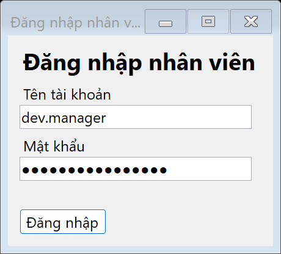
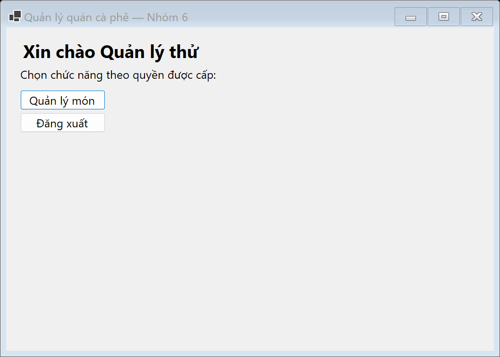

**Lệnh:**

```text
Nhật ký máy chủ (12 dòng cuối, đã kiểm: không có mật khẩu)
```
Kết quả:
```text
Using launch settings from src\CafeManager.Web\Properties\launchSettings.json...
info: Microsoft.Hosting.Lifetime[14]
      Now listening on: http://localhost:5055
info: Microsoft.Hosting.Lifetime[0]
      Application started. Press Ctrl+C to shut down.
info: Microsoft.Hosting.Lifetime[0]
      Hosting environment: Development
info: Microsoft.Hosting.Lifetime[0]
      Content root path: C:\Users\atnn2\source\repos\Domyan-nn\doan_CSharp\src\CafeManager.Web
warn: Microsoft.AspNetCore.HttpsPolicy.HttpsRedirectionMiddleware[3]
      Failed to determine the https port for redirect.
```

### KT02 – Đăng nhập sai (Desktop)

| Trường | Nội dung |
|---|---|
| Mã ca / lần chạy | KT02 – lần 1 |
| Ngày giờ, người chạy | 15/11/2026 09:03:42 → 15/11/2026 09:04:04; phụ trách theo kế hoạch: C; khởi chạy: A (công cụ tự động) |
| Phiên bản và môi trường | commit `7a8d253`; xem mục 1 |
| Dữ liệu, tiền điều kiện | Tài khoản dev.manager; máy chủ chạy rồi tắt để thử mất kết nối |
| Các bước đã làm | (1) Mở D00, nhập dev.manager với mật khẩu sai, bấm Đăng nhập.; (2) Tắt máy chủ Web rồi thử đăng nhập lại.; (3) Khởi động lại máy chủ Web sau khi thử. |
| Kết quả thực tế | xem danh sách kiểm tra, ảnh và SQL bên dưới |
| Trạng thái | **Đạt** |
| Lỗi và chạy lại | Không có lỗi trong lần chạy này. |

**Kiểm tra:**

- ✔ Sai mật khẩu: thông báo 'Sai tên tài khoản hoặc mật khẩu.'
- ✔ Không vào màn hình chính (D00 vẫn mở, chưa có kết quả OK)
- ✔ Ô mật khẩu được xóa
- ✔ Không có phiên: CurrentUser rỗng
- ✔ Máy chủ đã tắt (cổng 5055 không còn nghe)
- ✔ Mất kết nối: KHÔNG báo 'sai mật khẩu'
- ✔ Mất kết nối: nói rõ chưa kết nối/chưa xác định
- ✔ Máy chủ chạy lại bình thường

**Ảnh chụp:**

- [KT02-lan1-01.png](bang-chung/KT02-lan1-01.png) – D00 sau khi nhập sai mật khẩu: thông báo lỗi, ô mật khẩu trống
- [KT02-lan1-02.png](bang-chung/KT02-lan1-02.png) – D00 khi máy chủ đã tắt: thông báo chưa kết nối được, chưa xác định

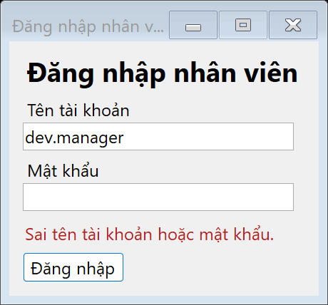
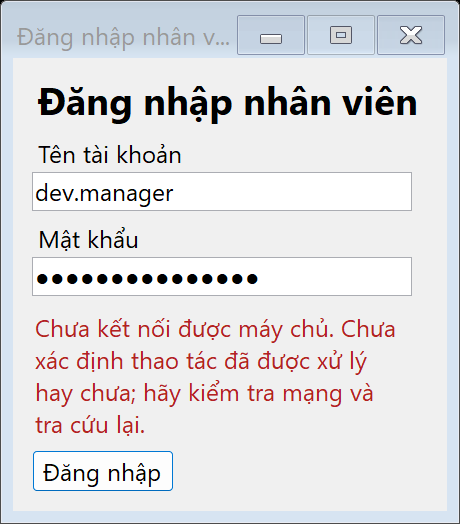

### KT03 – Chặn thao tác thiếu quyền

| Trường | Nội dung |
|---|---|
| Mã ca / lần chạy | KT03 – lần 1 |
| Ngày giờ, người chạy | 15/11/2026 09:04:04 → 15/11/2026 09:04:07; phụ trách theo kế hoạch: C; khởi chạy: A (công cụ tự động) |
| Phiên bản và môi trường | commit `7a8d253`; xem mục 1 |
| Dữ liệu, tiền điều kiện | Tài khoản dev.cashier (chỉ ORDER_RECEIVE) |
| Các bước đã làm | (1) Đăng nhập Desktop bằng dev.cashier; màn hình chính chỉ có Tiếp nhận đơn.; (2) Gọi thẳng API quản lý món bằng phiên thu ngân (lệnh PowerShell trong hướng dẫn). |
| Kết quả thực tế | xem danh sách kiểm tra, ảnh và SQL bên dưới |
| Trạng thái | **Đạt** |
| Lỗi và chạy lại | Không có lỗi trong lần chạy này. |

**Kiểm tra:**

- ✔ Đăng nhập dev.cashier qua ApiClient
- ✔ Màn hình chính thu ngân chỉ có 'Tiếp nhận đơn' và 'Đăng xuất' (không có 'Quản lý món')
- ✔ Quyền thu ngân đúng là ORDER_RECEIVE
- ✔ API quản lý món trả 403 cho phiên thu ngân
- ✔ Dữ liệu món không đổi (đếm và mã lớn nhất như trước)

**Ảnh chụp:**

- [KT03-lan1-01.png](bang-chung/KT03-lan1-01.png) – Màn hình chính của thu ngân (dev.cashier)

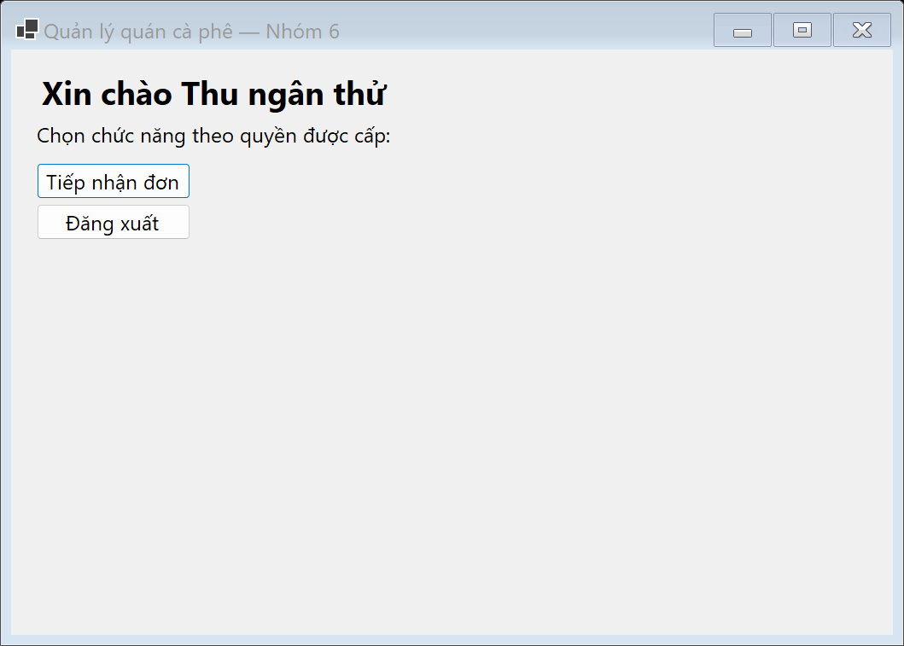

**SQL** (trước khi gọi):

```sql
SELECT COUNT(*), MAX(ProductId) FROM Product
```
```text
- -
3 3
```

**SQL** (sau khi gọi):

```sql
SELECT COUNT(*), MAX(ProductId) FROM Product
```
```text
- -
3 3
```

**Lệnh:**

```text
$b = 'http://localhost:5055'; $s = New-Object Microsoft.PowerShell.Commands.WebRequestSession
$null = Invoke-RestMethod "$b/api/auth/login" -Method Post -WebSession $s -ContentType 'application/json' -Body '{"userName":"dev.cashier","password":"<mật khẩu>"}'
try { Invoke-RestMethod "$b/api/staff/menu" -WebSession $s } catch { $_.Exception.Response.StatusCode.value__ }
```
Kết quả:
```text
403
```

### KT04 – Quản lý món (D06)

| Trường | Nội dung |
|---|---|
| Mã ca / lần chạy | KT04 – lần 1 |
| Ngày giờ, người chạy | 15/11/2026 09:04:07 → 15/11/2026 09:04:13; phụ trách theo kế hoạch: C; khởi chạy: A (công cụ tự động) |
| Phiên bản và môi trường | commit `7a8d253`; xem mục 1 |
| Dữ liệu, tiền điều kiện | Đăng nhập dev.manager; thêm "Món A" mới (khác món mẫu dùng cho KT06–KT21) |
| Các bước đã làm | (1) D06: Thêm món "Món A", chọn danh mục.; (2) Thêm biến thể "Vừa" (Đồ uống).; (3) Đổi giá 30.000, hiệu lực từ bây giờ.; (4) Công thức: một nguyên liệu, định lượng 15 cho một ly.; (5) Bật bán.; (6) Đổi giá thành 35.000.; (7) Gõ "mon a" (không dấu) vào ô Tìm. |
| Kết quả thực tế | xem danh sách kiểm tra, ảnh và SQL bên dưới |
| Trạng thái | **Đạt** |
| Lỗi và chạy lại | Không có lỗi trong lần chạy này. |

**Kiểm tra:**

- ✔ Đăng nhập dev.manager qua ApiClient
- ✔ Thêm món 'Món A': dòng mới hiện 'Chưa có biến thể'
- ✔ Thêm biến thể 'Vừa': 'Chưa bán: thiếu giá và công thức'; nút Bật bán tắt
- ✔ Đổi giá 30.000: 'Chưa bán: thiếu công thức'
- ✔ Có giá và công thức: 'Chưa bán: sẵn sàng bật bán'; nút Bật bán bật
- ✔ Bật bán: trạng thái 'Đang bán'
- ✔ Đổi giá 35.000: lưới hiện giá mới, vẫn Đang bán
- ✔ Gõ 'mon a' (không dấu) lọc ra món 'Món A'
- ✔ PriceHistory: 2 phiên bản; giá cũ 30.000 được đóng EffectiveTo bằng EffectiveFrom của giá mới 35.000; giá mới còn mở
- ✔ Món A hiện trên Web (/danh-muc) với giá 35.000 đ sau khi bật bán

**Ảnh chụp:**

- [KT04-lan1-01.png](bang-chung/KT04-lan1-01.png) – D06: danh sách món lúc mở
- [KT04-lan1-02.png](bang-chung/KT04-lan1-02.png) – Hộp thoại Thêm món: tên 'Món A', danh mục đã chọn
- [KT04-lan1-03.png](bang-chung/KT04-lan1-03.png) – D06 sau khi thêm món 'Món A' (chưa có biến thể)
- [KT04-lan1-04.png](bang-chung/KT04-lan1-04.png) – D06 sau khi thêm biến thể 'Vừa': chưa bán, thiếu giá và công thức
- [KT04-lan1-05.png](bang-chung/KT04-lan1-05.png) – D06 sau khi đặt giá 30.000: còn thiếu công thức
- [KT04-lan1-06.png](bang-chung/KT04-lan1-06.png) – Hộp thoại Công thức: một nguyên liệu, định lượng 15 cho một ly
- [KT04-lan1-07.png](bang-chung/KT04-lan1-07.png) – D06 sau khi có công thức: sẵn sàng bật bán
- [KT04-lan1-08.png](bang-chung/KT04-lan1-08.png) – D06 sau Bật bán: Đang bán
- [KT04-lan1-09.png](bang-chung/KT04-lan1-09.png) – D06 sau khi đổi giá thành 35.000
- [KT04-lan1-10.png](bang-chung/KT04-lan1-10.png) – D06 khi gõ 'mon a' vào ô Tìm
- [KT04-lan1-11.png](bang-chung/KT04-lan1-11.png) – Web /danh-muc: Món A đã hiện với giá 35.000 đ


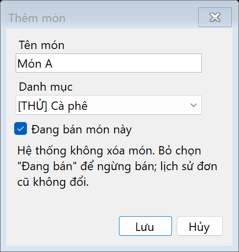
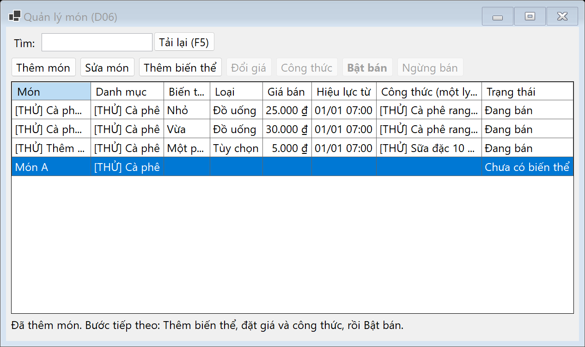
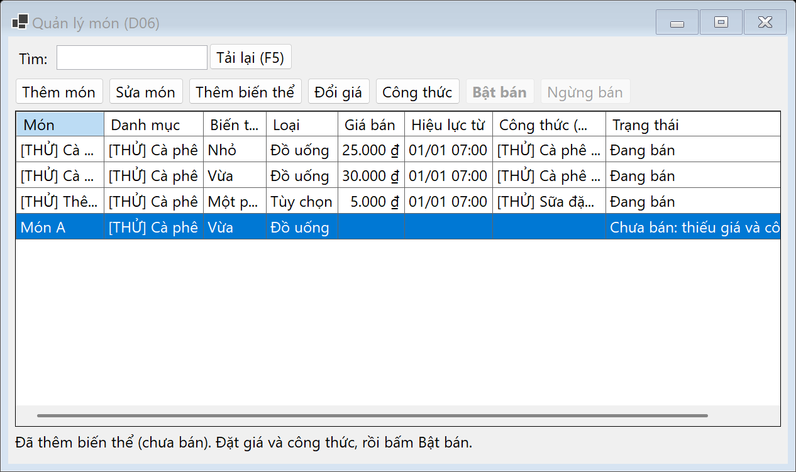
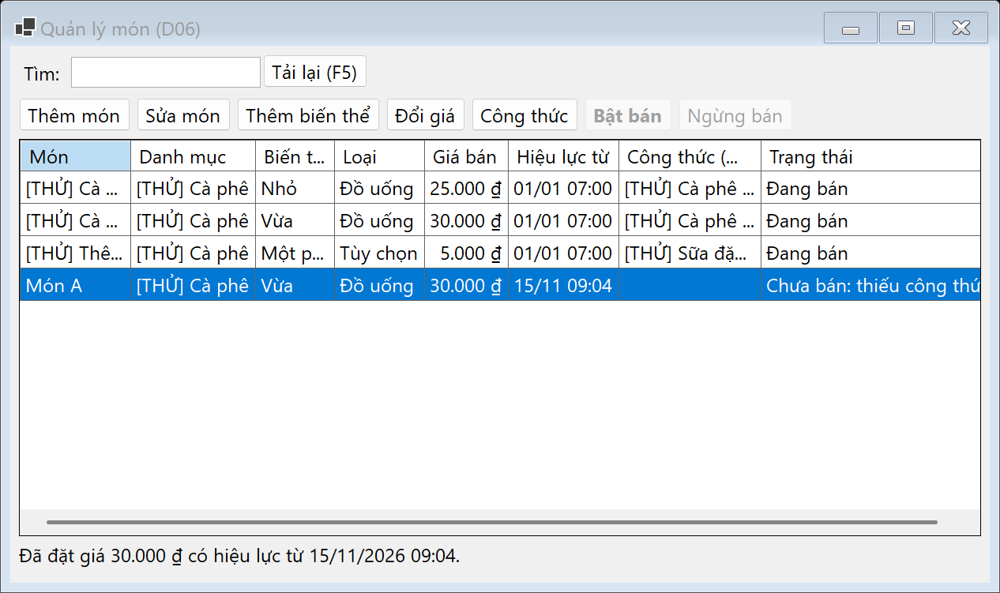
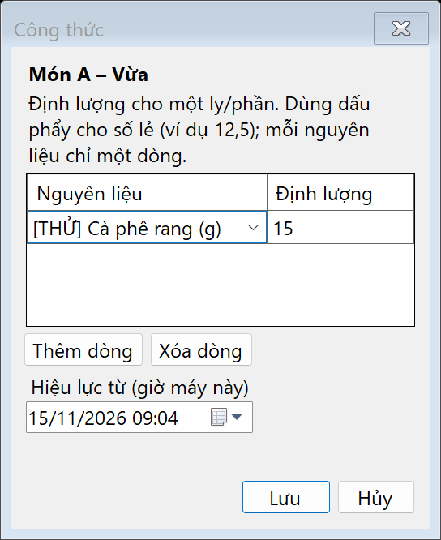
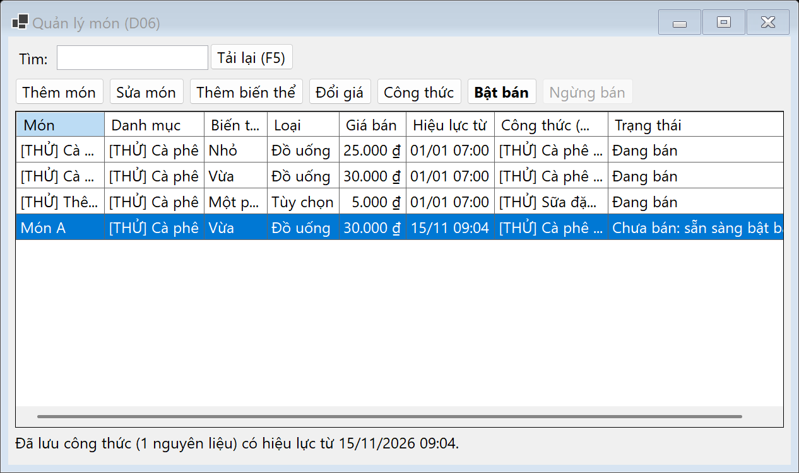
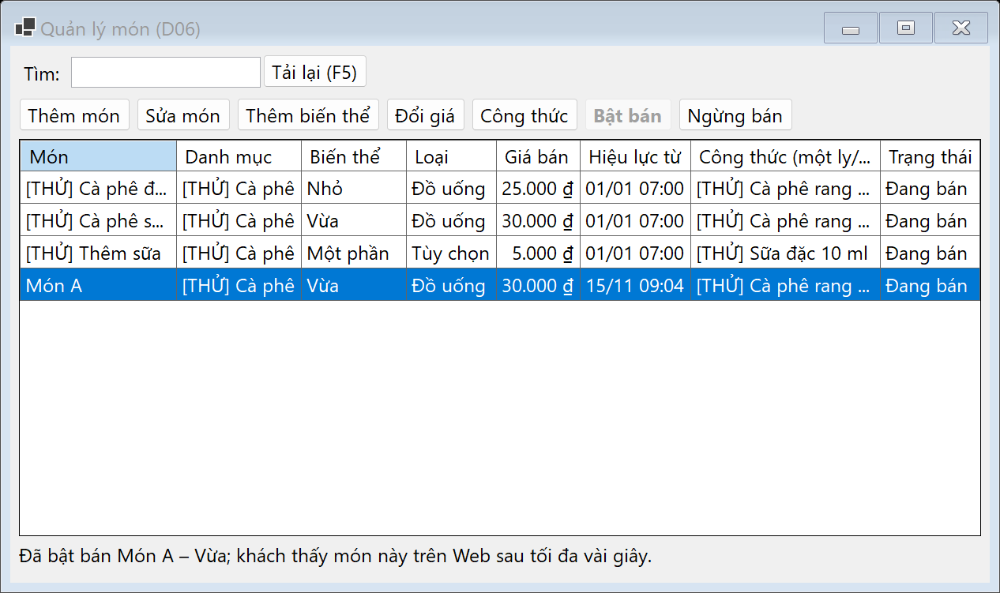
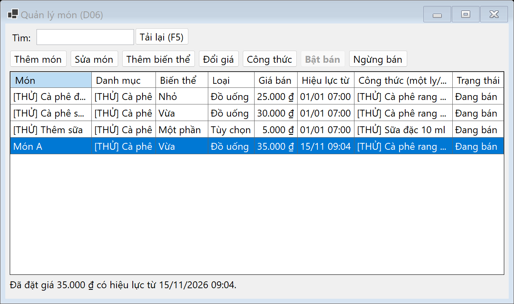
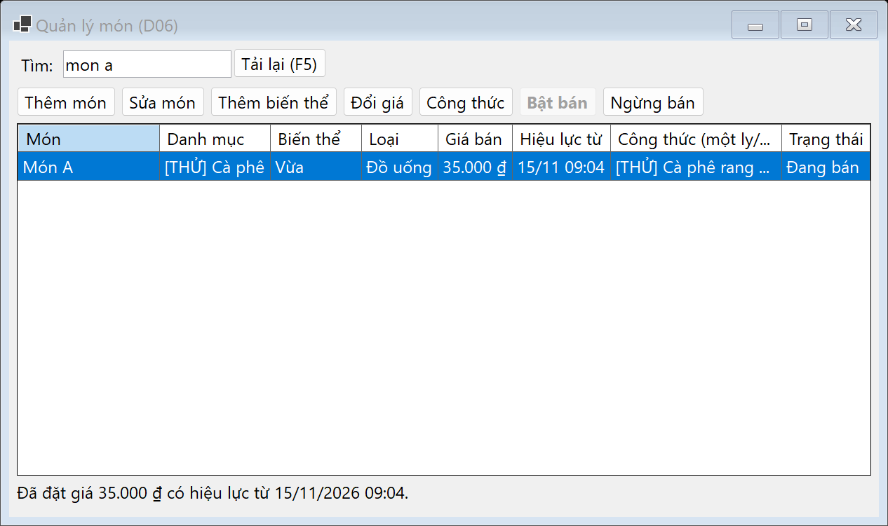


**SQL** (phiên bản giá của biến thể Món A):

```sql
SELECT PriceHistoryId, UnitPrice, EffectiveFrom, EffectiveTo FROM PriceHistory WHERE VariantId = 4 ORDER BY EffectiveFrom;
```
```text
PriceHistoryId UnitPrice EffectiveFrom EffectiveTo
-------------- --------- ------------- -----------
4 30000.00 2026-11-15 02:04:10.1976599 2026-11-15 02:04:11.4015069
5 35000.00 2026-11-15 02:04:11.4015069 NULL
```

### KT05 – Dữ liệu món không hợp lệ

| Trường | Nội dung |
|---|---|
| Mã ca / lần chạy | KT05 – lần 1 |
| Ngày giờ, người chạy | 15/11/2026 09:04:13 → 15/11/2026 09:04:16; phụ trách theo kế hoạch: C; khởi chạy: A (công cụ tự động) |
| Phiên bản và môi trường | commit `7a8d253`; xem mục 1 |
| Dữ liệu, tiền điều kiện | Đăng nhập dev.manager; đếm dòng trước/sau |
| Các bước đã làm | (1) D06 → Thêm món để trống tên, bấm Lưu.; (2) Đổi giá nhập -1, bấm Lưu.; (3) Thử thêm "abc" và "35.00". |
| Kết quả thực tế | xem danh sách kiểm tra, ảnh và SQL bên dưới |
| Trạng thái | **Đạt** |
| Lỗi và chạy lại | Không có lỗi trong lần chạy này. |

**Kiểm tra:**

- ✔ Đăng nhập dev.manager qua ApiClient
- ✔ Thêm món trống tên: hộp thoại không đóng
- ✔ Thông báo gần trường: 'Nhập tên món.'
- ✔ Đổi giá -1: hộp thoại không đóng và báo 'Giá không được âm…'
- ✔ Đổi giá 'abc': hộp thoại không đóng và báo 'Giá không hợp lệ…'
- ✔ Đổi giá '35.00': hộp thoại không đóng và báo 'Giá không hợp lệ…'
- ✔ Cả ba giá không hợp lệ đều bị chặn ở hộp thoại (không gọi lưu)
- ✔ Số dòng Product và PriceHistory không đổi

**Ảnh chụp:**

- [KT05-lan1-01.png](bang-chung/KT05-lan1-01.png) – Thêm món để trống tên: báo lỗi 'Nhập tên món.' gần ô, hộp thoại không đóng
- [KT05-lan1-02.png](bang-chung/KT05-lan1-02.png) – Đổi giá -1: báo lỗi gần ô giá
- [KT05-lan1-03.png](bang-chung/KT05-lan1-03.png) – Đổi giá 'abc': báo lỗi gần ô giá
- [KT05-lan1-04.png](bang-chung/KT05-lan1-04.png) – Đổi giá '35.00': báo lỗi gần ô giá

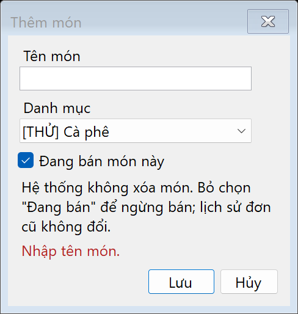
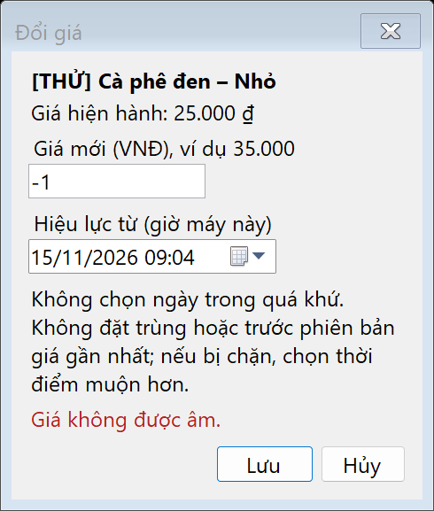
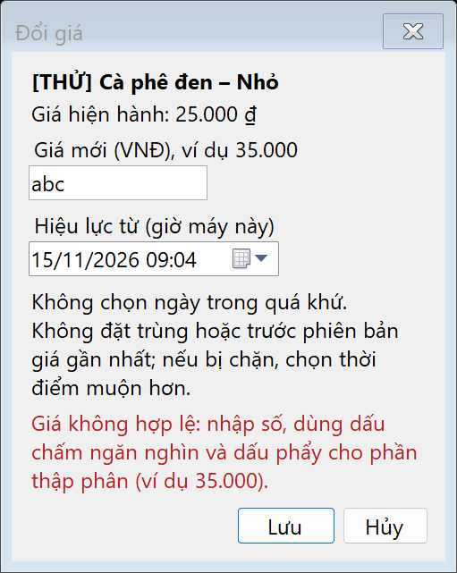
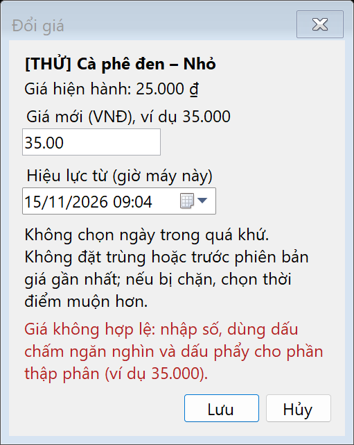

**SQL** (trước):

```sql
SELECT (SELECT COUNT(*) FROM Product) AS SoMon, (SELECT COUNT(*) FROM PriceHistory) AS SoPhienBanGia
```
```text
SoMon SoPhienBanGia
----- -------------
4 5
```

**SQL** (sau):

```sql
SELECT (SELECT COUNT(*) FROM Product) AS SoMon, (SELECT COUNT(*) FROM PriceHistory) AS SoPhienBanGia
```
```text
SoMon SoPhienBanGia
----- -------------
4 5
```

### KT06 – Tìm và xem món trên Web

| Trường | Nội dung |
|---|---|
| Mã ca / lần chạy | KT06 – lần 1 |
| Ngày giờ, người chạy | 15/11/2026 09:04:16 → 15/11/2026 09:04:20; phụ trách theo kế hoạch: B; khởi chạy: A (công cụ tự động) |
| Phiên bản và môi trường | commit `7a8d253`; xem mục 1 |
| Dữ liệu, tiền điều kiện | Món A trong các ca KT06–KT21 là món mẫu "[THỬ] Cà phê sữa" (30.000 đ); khách chưa đăng nhập |
| Các bước đã làm | (1) Mở http://localhost:5055/ và gõ tên món vào ô tìm.; (2) Chọn biến thể và tùy chọn thêm (1 phần sữa).; (3) Tìm một tên không tồn tại.; (4) Thu nhỏ cửa sổ về 360 px. |
| Kết quả thực tế | xem danh sách kiểm tra, ảnh và SQL bên dưới |
| Trạng thái | **Đạt** |
| Lỗi và chạy lại | Không có lỗi trong lần chạy này. |

**Kiểm tra:**

- ✔ Kết quả chỉ có đúng món cần tìm, giá hiện hành 30.000 đ và tùy chọn Thêm sữa
- ✔ Tên không có: thông báo "Không tìm thấy món phù hợp." và nút quay về thực đơn
- ✔ Thực đơn ở 360 px: không tràn ngang (scrollWidth 345 ≤ 360)
- ✔ Trang trống ở 360 px: không tràn ngang (scrollWidth 360 ≤ 360)

**Ảnh chụp:**

- [KT06-lan1-01.png](bang-chung/KT06-lan1-01.png) – Kết quả tìm "cà phê sữa" ở 1280 px, đã chọn 1 phần Thêm sữa
- [KT06-lan1-02.png](bang-chung/KT06-lan1-02.png) – Trang trống khi tìm tên không tồn tại
- [KT06-lan1-03.png](bang-chung/KT06-lan1-03.png) – Thực đơn ở 360 px
- [KT06-lan1-04.png](bang-chung/KT06-lan1-04.png) – Trang trống ở 360 px

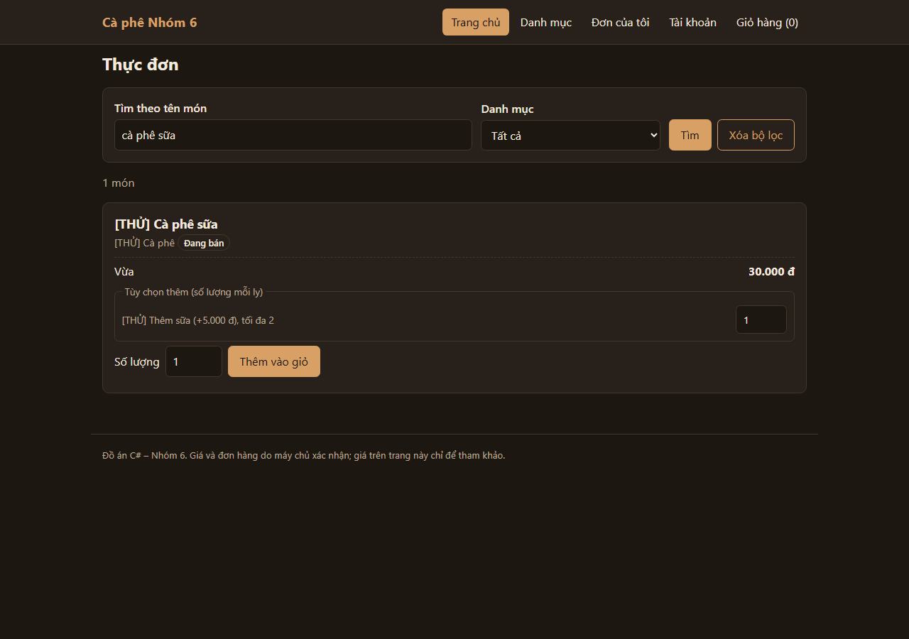
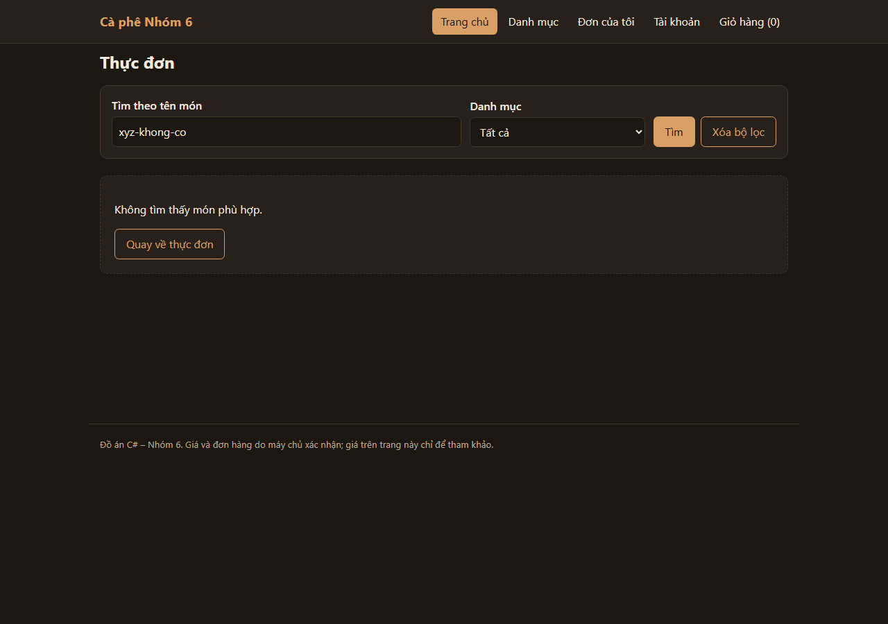
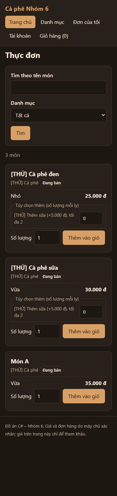
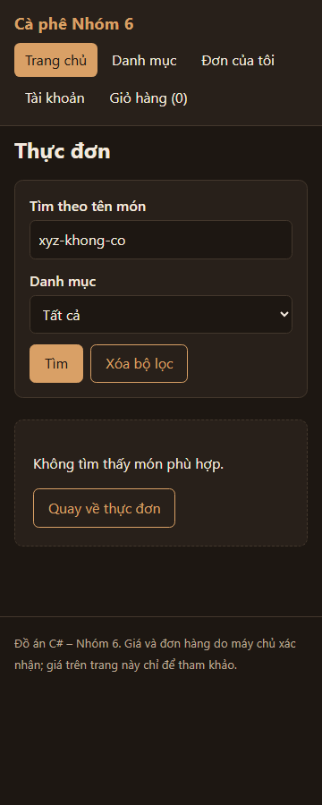

### KT07 – Đặt đơn trên Web

| Trường | Nội dung |
|---|---|
| Mã ca / lần chạy | KT07 – lần 1 |
| Ngày giờ, người chạy | 15/11/2026 09:04:27 → 15/11/2026 09:04:32; phụ trách theo kế hoạch: B; khởi chạy: A (công cụ tự động) |
| Phiên bản và môi trường | commit `7a8d253`; xem mục 1 |
| Dữ liệu, tiền điều kiện | Đăng nhập dev.customer; Món A = "[THỬ] Cà phê sữa" 30.000 đ; không dùng tùy chọn |
| Các bước đã làm | (1) Đăng nhập dev.customer; thêm 2 Món A vào giỏ.; (2) /gio-hang → Đặt hàng (/dat-hang), chọn giờ nhận hợp lệ, xác nhận. |
| Kết quả thực tế | Mã đơn của ca này: WEB-261115-3BLBARFM |
| Trạng thái | **Đạt** |
| Lỗi và chạy lại | Không có lỗi trong lần chạy này. |

**Kiểm tra:**

- ✔ Giỏ hiện 2 × 30.000 đ = 60.000 đ
- ✔ Nhận mã đơn và mã nhận hàng, trạng thái "Chờ tiếp nhận", tổng 60.000 đ
- ✔ SQL 1: Pending, số lượng 2, giá chốt 30000
- ✔ SQL 2: chưa có phiếu (0)
- ✔ SQL 3: QuantityReserved chưa đổi

**Ảnh chụp:**

- [KT07-lan1-01.png](bang-chung/KT07-lan1-01.png) – Giỏ hàng: 2 Món A, tạm tính 60.000 đ
- [KT07-lan1-02.png](bang-chung/KT07-lan1-02.png) – Trang đặt hàng: đã nhập giờ nhận (ngày mai 10:00), tên và số điện thoại
- [KT07-lan1-03.png](bang-chung/KT07-lan1-03.png) – Xác nhận đặt đơn: mã đơn WEB-261115-3BLBARFM

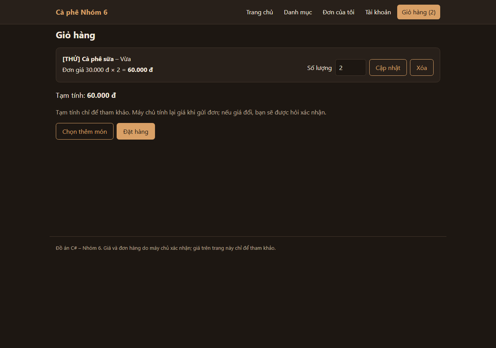


**SQL** (tồn kho trước khi đặt):

```sql
SELECT IngredientId, QuantityOnHand, QuantityReserved FROM StockBalance ORDER BY IngredientId
```
```text
IngredientId QuantityOnHand QuantityReserved
------------ -------------- ----------------
1 10000.000 .000
2 10000.000 .000
```

**SQL** (đơn và dòng món):

```sql
SELECT o.OrderCode, o.Status, o.ExpectedPickupAt, o.ContactName, l.ProductNameSnapshot, l.Quantity, l.UnitPriceSnapshot
FROM SalesOrder o JOIN OrderRound r ON r.OrderId = o.OrderId JOIN OrderLine l ON l.RoundId = r.RoundId WHERE o.OrderCode = N'WEB-261115-3BLBARFM';
```
```text
OrderCode Status ExpectedPickupAt ContactName ProductNameSnapshot Quantity UnitPriceSnapshot
--------- ------ ---------------- ----------- ------------------- -------- -----------------
WEB-261115-3BLBARFM Pending 2026-11-16 03:00:00.0000000 Khach A Thu Nghiem [THỬ] Cà phê sữa 2 30000.00
```

**SQL** (số phiếu pha chế):

```sql
SELECT COUNT(*) AS SoPhieu FROM PreparationTicket t JOIN OrderRound r ON r.RoundId = t.RoundId JOIN SalesOrder o ON o.OrderId = r.OrderId WHERE o.OrderCode = N'WEB-261115-3BLBARFM';
```
```text
SoPhieu
-------
0
```

**SQL** (tồn kho sau khi đặt):

```sql
SELECT IngredientId, QuantityOnHand, QuantityReserved FROM StockBalance ORDER BY IngredientId
```
```text
IngredientId QuantityOnHand QuantityReserved
------------ -------------- ----------------
1 10000.000 .000
2 10000.000 .000
```

### KT08 – Tiếp nhận đơn Web (D02)

| Trường | Nội dung |
|---|---|
| Mã ca / lần chạy | KT08 – lần 1 |
| Ngày giờ, người chạy | 15/11/2026 09:04:32 → 15/11/2026 09:04:39; phụ trách theo kế hoạch: C; khởi chạy: A (công cụ tự động) |
| Phiên bản và môi trường | commit `7a8d253`; xem mục 1 |
| Dữ liệu, tiền điều kiện | Có đơn của KT07 đang chờ; tạo thêm một đơn khác để từ chối; đăng nhập dev.cashier |
| Các bước đã làm | (1) Tạo thêm một đơn trên Web để thử Từ chối.; (2) Đăng nhập Desktop dev.cashier → Tiếp nhận đơn.; (3) Chọn đơn WEB-261115-3BLBARFM, xem chi tiết.; (4) Bấm Tiếp nhận đơn → Có.; (5) Chọn đơn WEB-261115-3N6BU7B4, Từ chối đơn…: để trống lý do rồi nhập lý do. |
| Kết quả thực tế | Đơn tiếp nhận: WEB-261115-3BLBARFM; đơn từ chối: WEB-261115-3N6BU7B4; Chi tiết dòng món: [THỬ] Cà phê sữa ; Vừa ; 2 ; 30.000 ₫ ;  ; 60.000 ₫ |
| Trạng thái | **Đạt** |
| Lỗi và chạy lại | Không có lỗi trong lần chạy này. |

**Kiểm tra:**

- ✔ Đăng nhập dev.cashier qua ApiClient
- ✔ Danh sách đơn chờ có đơn WEB-261115-3BLBARFM
- ✔ Chi tiết hiện đúng món, số lượng, tùy chọn và giá chốt
- ✔ Hộp thoại xác nhận nêu đúng mã đơn
- ✔ Sau khi tiếp nhận: đơn rời danh sách chờ, thanh trạng thái báo đã tiếp nhận
- ✔ Từ chối để trống lý do bị chặn; có lý do thì thành công
- ✔ SQL: đơn tiếp nhận có Status = Serving
- ✔ SQL: có đúng một dòng ở PreparationTicket
- ✔ SQL: QuantityReserved tăng đúng công thức (2 ly × 20 = 40 cà phê rang; 2 ly × 25 = 50 sữa đặc)
- ✔ SQL: đơn từ chối có Status=Rejected, RejectReason, RejectedBy, RejectedAt có giá trị
- ✔ SQL: đơn từ chối không có phiếu
- ✔ Web "Đơn của tôi": đơn tiếp nhận hiện "Đang phục vụ"
- ✔ Web: đơn từ chối hiện "Bị từ chối" kèm lý do

**Ảnh chụp:**

- [KT08-lan1-01.png](bang-chung/KT08-lan1-01.png) – D02 trước khi tiếp nhận: đơn WEB-261115-3BLBARFM được chọn, chi tiết món bên dưới
- [KT08-lan1-02.png](bang-chung/KT08-lan1-02.png) – Hộp thoại: &Có | &Không | Tiếp nhận đơn WEB-261115-3BLBARFM?
- [KT08-lan1-03.png](bang-chung/KT08-lan1-03.png) – D02 sau khi tiếp nhận đơn WEB-261115-3BLBARFM
- [KT08-lan1-04.png](bang-chung/KT08-lan1-04.png) – Từ chối để trống lý do: bị chặn trong hộp thoại
- [KT08-lan1-05.png](bang-chung/KT08-lan1-05.png) – D02 sau khi từ chối đơn WEB-261115-3N6BU7B4 với lý do
- [KT08-lan1-06.png](bang-chung/KT08-lan1-06.png) – Web: đơn WEB-261115-3BLBARFM sau khi tiếp nhận (Đang phục vụ)
- [KT08-lan1-07.png](bang-chung/KT08-lan1-07.png) – Web: đơn WEB-261115-3N6BU7B4 bị từ chối, có lý do

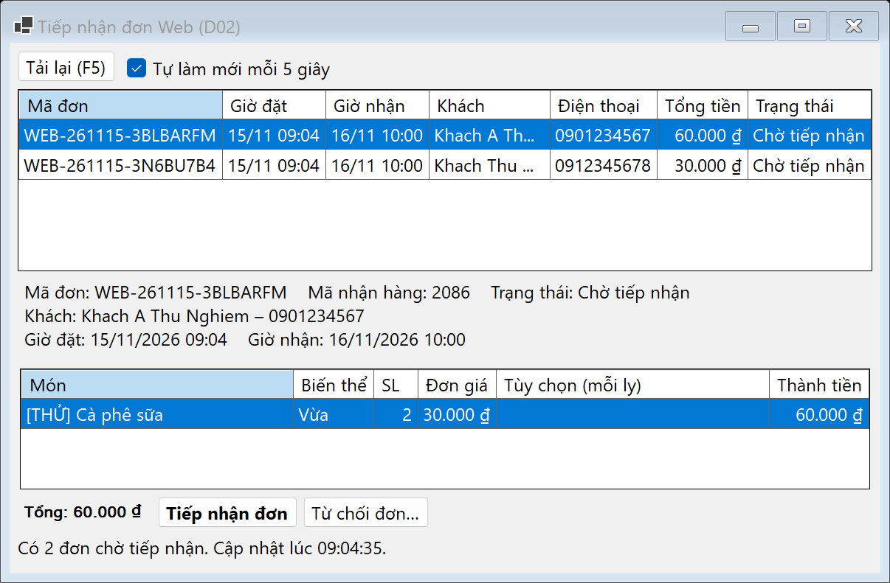
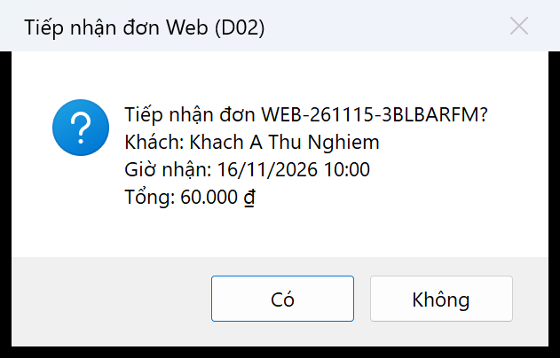
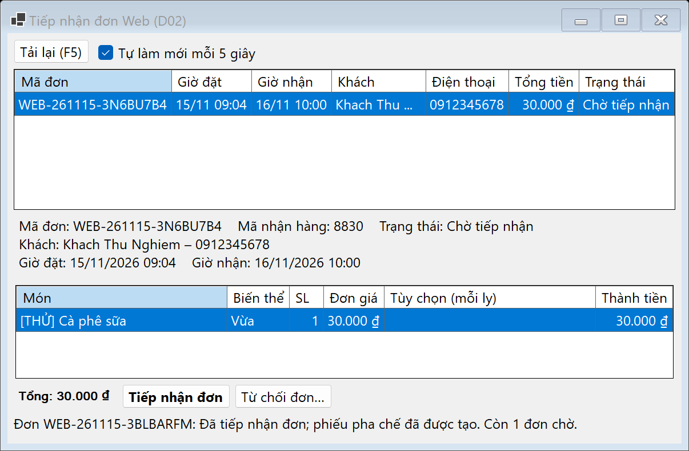
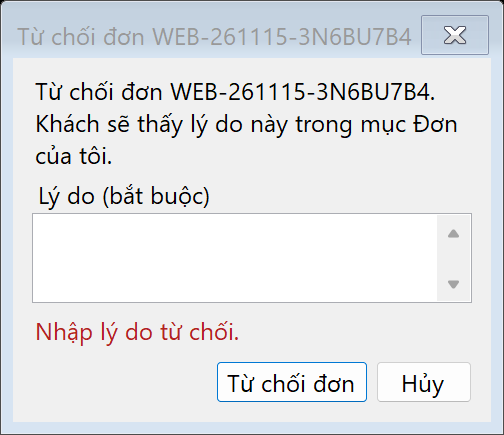
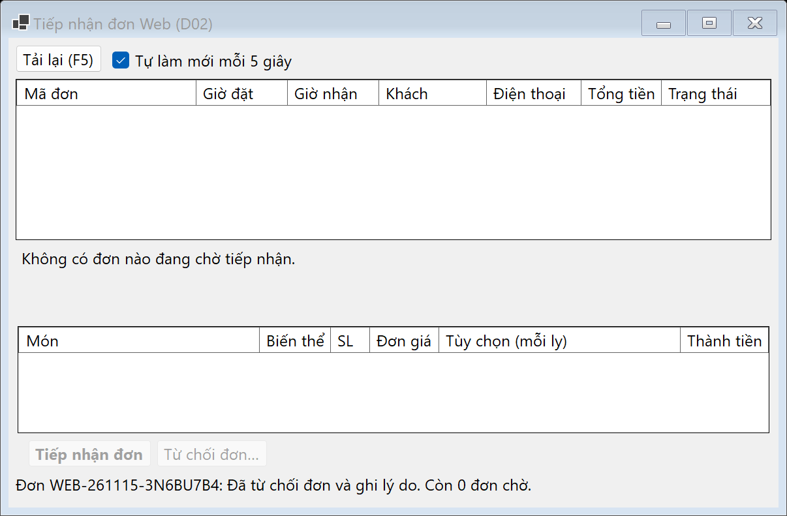

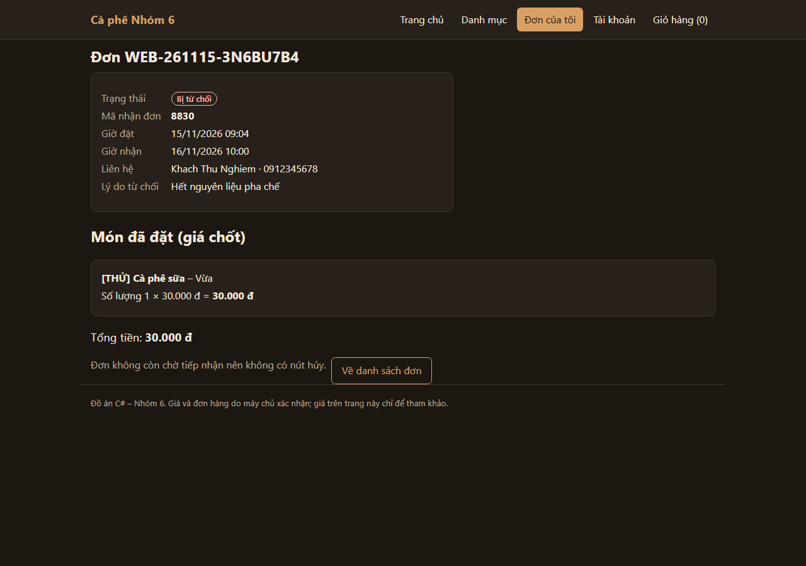

**SQL** (tồn kho trước khi tiếp nhận):

```sql
SELECT IngredientId, QuantityOnHand, QuantityReserved FROM StockBalance ORDER BY IngredientId
```
```text
IngredientId QuantityOnHand QuantityReserved
------------ -------------- ----------------
1 10000.000 .000
2 10000.000 .000
```

**SQL** (trạng thái đơn tiếp nhận):

```sql
SELECT Status FROM SalesOrder WHERE OrderCode = N'WEB-261115-3BLBARFM'
```
```text
Status
------
Serving
```

**SQL** (số phiếu của đơn tiếp nhận):

```sql
SELECT COUNT(*) FROM PreparationTicket t JOIN OrderRound r ON r.RoundId = t.RoundId JOIN SalesOrder o ON o.OrderId = r.OrderId WHERE o.OrderCode = N'WEB-261115-3BLBARFM'
```
```text
-
1
```

**SQL** (tồn kho sau khi tiếp nhận):

```sql
SELECT IngredientId, QuantityOnHand, QuantityReserved FROM StockBalance ORDER BY IngredientId
```
```text
IngredientId QuantityOnHand QuantityReserved
------------ -------------- ----------------
1 10000.000 40.000
2 10000.000 50.000
```

**SQL** (đơn bị từ chối):

```sql
SELECT Status, RejectReason, RejectedBy, RejectedAt FROM SalesOrder WHERE OrderCode = N'WEB-261115-3N6BU7B4'
```
```text
Status RejectReason RejectedBy RejectedAt
------ ------------ ---------- ----------
Rejected Hết nguyên liệu pha chế 2 2026-11-15 02:04:37.2101221
```

**SQL** (số phiếu của đơn từ chối):

```sql
SELECT COUNT(*) FROM PreparationTicket t JOIN OrderRound r ON r.RoundId = t.RoundId JOIN SalesOrder o ON o.OrderId = r.OrderId WHERE o.OrderCode = N'WEB-261115-3N6BU7B4'
```
```text
-
0
```

### KT09 – Dữ liệu dùng chung giữa Web, Desktop và SQL

| Trường | Nội dung |
|---|---|
| Mã ca / lần chạy | KT09 – lần 1 |
| Ngày giờ, người chạy | 15/11/2026 09:04:39 → 15/11/2026 09:04:53; phụ trách theo kế hoạch: C (B hỗ trợ Web); khởi chạy: A (công cụ tự động) |
| Phiên bản và môi trường | commit `7a8d253`; xem mục 1 |
| Dữ liệu, tiền điều kiện | Sau KT04, KT07, KT08; Món A = "[THỬ] Cà phê sữa"; dev.customer đăng nhập |
| Các bước đã làm | (1) Tạo thêm một đơn đang chờ để đối chiếu ở D02.; (2) 1. So sánh giá Món A trên Web (/danh-muc), D06 và SQL (PriceHistory).; (3) 2. So sánh mã đơn, dòng món, giá chốt ở Web ("Đơn của tôi"), D02 (đơn chờ) và SQL.; (4) 3. Đổi giá Món A (D06) rồi mở lại đơn cũ. |
| Kết quả thực tế | D06: [THỬ] Cà phê sữa ; [THỬ] Cà phê ; Vừa ; Đồ uống ; 30.000 ₫ ; 01/01 07:00 ; [THỬ] Cà phê rang 20 g; [THỬ] Sữa đặc 25 ml ; Đang bán; D02 danh sách: WEB-261115-MGUL553R ; 15/11 09:04 ; 16/11 10:00 ; Khach Thu Nghiem ; 0912345678 ; 30.000 ₫ ; Chờ tiếp nhận; D02 chi tiết: [THỬ] Cà phê sữa ; Vừa ; 1 ; 30.000 ₫ ;  ; 30.000 ₫; Dòng trước khi đổi giá: [THỬ] Cà phê sữa ; [THỬ] Cà phê ; Vừa ; Đồ uống ; 30.000 ₫ ; 01/01 07:00 ; [THỬ] Cà phê rang 20 g; [THỬ] Sữa đặc 25 ml ; Đang bán; Thực đơn Web hiện giá mới sau khoảng 2.5 giây kể từ lúc đổi giá ở D06 (thực đơn Web có bộ nhớ đệm ngắn; giá chính thức vẫn do máy chủ xác nhận khi gửi đơn) |
| Trạng thái | **Đạt** |
| Lỗi và chạy lại | Không có lỗi trong lần chạy này. |

**Kiểm tra:**

- ✔ Đăng nhập dev.manager qua ApiClient
- ✔ D06 hiện món 'Cà phê sữa'
- ✔ Giá hiện hành khớp ở Web, D06 và SQL (30.000)
- ✔ Đăng nhập dev.cashier qua ApiClient
- ✔ D02 hiện đơn chờ WEB-261115-MGUL553R
- ✔ Mã đơn, món, số lượng và giá chốt khớp ở Web, D02 và SQL
- ✔ Đăng nhập dev.manager qua ApiClient
- ✔ Đổi giá 'Cà phê sữa' thành 32.000 (hiệu lực ngay) được nhận
- ✔ Web /danh-muc hiện giá mới 32.000 đ
- ✔ Đơn cũ vẫn hiện giá chốt cũ 30.000 đ, tổng 60.000 đ
- ✔ SQL: UnitPriceSnapshot của đơn cũ vẫn 30000

**Ảnh chụp:**

- [KT09-lan1-01.png](bang-chung/KT09-lan1-01.png) – Web /danh-muc: giá "[THỬ] Cà phê sữa" (30.000 đ)
- [KT09-lan1-02.png](bang-chung/KT09-lan1-02.png) – D06: dòng 'Cà phê sữa' với giá hiện hành
- [KT09-lan1-03.png](bang-chung/KT09-lan1-03.png) – Web "Đơn của tôi": chi tiết đơn WEB-261115-MGUL553R
- [KT09-lan1-04.png](bang-chung/KT09-lan1-04.png) – D02: đơn chờ WEB-261115-MGUL553R và chi tiết dòng món (giá chốt)
- [KT09-lan1-05.png](bang-chung/KT09-lan1-05.png) – D06 trước khi đổi giá 'Cà phê sữa'
- [KT09-lan1-06.png](bang-chung/KT09-lan1-06.png) – Hộp thoại Đổi giá: 32.000, hiệu lực từ bây giờ
- [KT09-lan1-07.png](bang-chung/KT09-lan1-07.png) – D06 sau khi đổi giá 'Cà phê sữa' thành 32.000
- [KT09-lan1-08.png](bang-chung/KT09-lan1-08.png) – Web /danh-muc sau khi đổi giá: 32.000 đ
- [KT09-lan1-09.png](bang-chung/KT09-lan1-09.png) – Web: đơn cũ WEB-261115-3BLBARFM sau khi đổi giá vẫn giữ giá chốt 30.000 đ

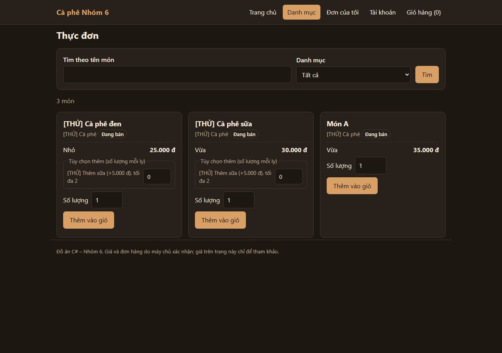


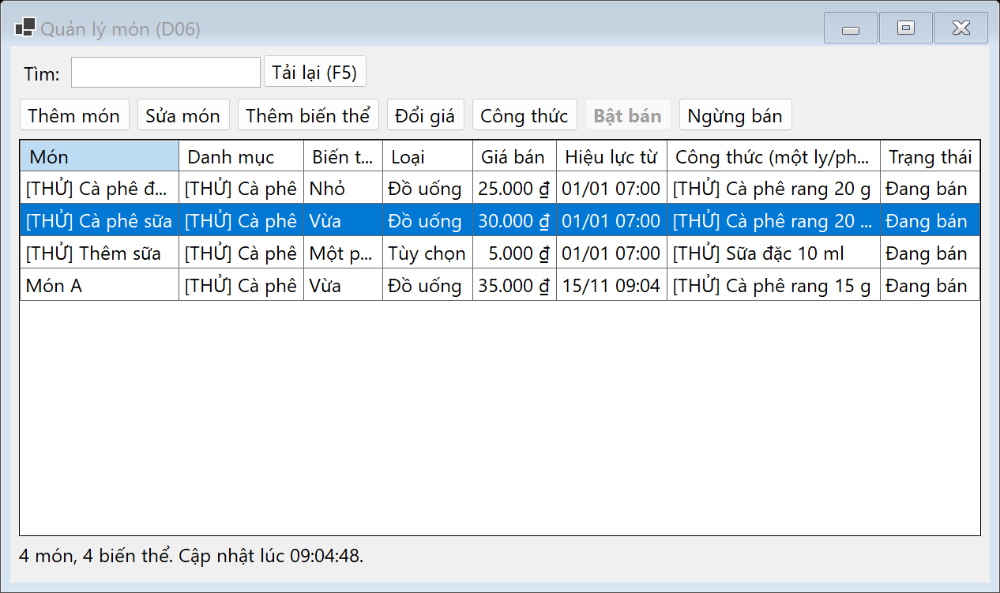


**SQL** (giá hiện hành của biến thể mẫu):

```sql
SELECT TOP 1 UnitPrice, EffectiveFrom, EffectiveTo FROM PriceHistory WHERE VariantId = 2 AND EffectiveTo IS NULL ORDER BY EffectiveFrom DESC
```
```text
UnitPrice EffectiveFrom EffectiveTo
--------- ------------- -----------
30000.00 2026-01-01 00:00:00.0000000 NULL
```

**SQL** (dòng của đơn đối chiếu):

```sql
SELECT o.OrderCode, o.Status, l.ProductNameSnapshot, l.Quantity, l.UnitPriceSnapshot FROM SalesOrder o JOIN OrderRound r ON r.OrderId = o.OrderId JOIN OrderLine l ON l.RoundId = r.RoundId WHERE o.OrderCode = N'WEB-261115-MGUL553R'
```
```text
OrderCode Status ProductNameSnapshot Quantity UnitPriceSnapshot
--------- ------ ------------------- -------- -----------------
WEB-261115-MGUL553R Pending [THỬ] Cà phê sữa 1 30000.00
```

**SQL** (giá chốt của đơn cũ):

```sql
SELECT l.UnitPriceSnapshot FROM SalesOrder o JOIN OrderRound r ON r.OrderId = o.OrderId JOIN OrderLine l ON l.RoundId = r.RoundId WHERE o.OrderCode = N'WEB-261115-3BLBARFM'
```
```text
UnitPriceSnapshot
-----------------
30000.00
```

### KT10 – Giá thay đổi trước khi xác nhận

| Trường | Nội dung |
|---|---|
| Mã ca / lần chạy | KT10 – lần 1 |
| Ngày giờ, người chạy | 15/11/2026 09:04:53 → 15/11/2026 09:04:58; phụ trách theo kế hoạch: B (cần người đổi giá ở D06); khởi chạy: A (công cụ tự động) |
| Phiên bản và môi trường | commit `7a8d253`; xem mục 1 |
| Dữ liệu, tiền điều kiện | Giá hiện tại của "[THỬ] Cà phê sữa" là 32.000 đ sau KT09; dev.customer |
| Các bước đã làm | (1) Khách bỏ Món A vào giỏ, mở trang đặt hàng nhưng chưa gửi.; (2) Người khác dùng D06 đổi giá Món A thành 35.000 (hiệu lực ngay).; (3) Khách bấm xác nhận gửi.; (4) Khách đồng ý giá mới (xác nhận lại). |
| Kết quả thực tế | Dòng trước khi đổi giá: [THỬ] Cà phê sữa ; [THỬ] Cà phê ; Vừa ; Đồ uống ; 32.000 ₫ ; 15/11 09:04 ; [THỬ] Cà phê rang 20 g; [THỬ] Sữa đặc 25 ml ; Đang bán |
| Trạng thái | **Đạt** |
| Lỗi và chạy lại | Không có lỗi trong lần chạy này. |

> **Lưu ý:** Quan sát: thực đơn Web có thể còn hiện giá cũ vài giây sau khi đổi giá ở D06 (bộ nhớ đệm ngắn). Khi đó giá chính thức vẫn do máy chủ xác nhận ở bước gửi đơn bằng cảnh báo "Giá đã thay đổi". Ở lần chạy này, đơn phụ tạo ngay sau KT10 gặp đúng cảnh báo đó và được đồng ý giá mới trước khi chạy tiếp KT14.

**Kiểm tra:**

- ✔ Đăng nhập dev.manager qua ApiClient
- ✔ Đổi giá 'Cà phê sữa' thành 35.000 (hiệu lực ngay) được nhận
- ✔ Web báo giá đã thay đổi, hiện giá cũ 32.000 và giá mới 35.000, đơn chưa được gửi
- ✔ SQL: không có đơn mới sau bước gửi
- ✔ Đồng ý giá mới: đơn được tạo, tổng 35.000 đ
- ✔ SQL: UnitPriceSnapshot = 35000

**Ảnh chụp:**

- [KT10-lan1-01.png](bang-chung/KT10-lan1-01.png) – Trang đặt hàng đã nhập đủ thông tin, chưa gửi (giá đang xem 32.000 đ)
- [KT10-lan1-02.png](bang-chung/KT10-lan1-02.png) – D06 trước khi đổi giá 'Cà phê sữa'
- [KT10-lan1-03.png](bang-chung/KT10-lan1-03.png) – Hộp thoại Đổi giá: 35.000, hiệu lực từ bây giờ
- [KT10-lan1-04.png](bang-chung/KT10-lan1-04.png) – D06 sau khi đổi giá 'Cà phê sữa' thành 35.000
- [KT10-lan1-05.png](bang-chung/KT10-lan1-05.png) – Cảnh báo giá đã thay đổi: giá cũ 32.000 → giá mới 35.000, đơn chưa gửi
- [KT10-lan1-06.png](bang-chung/KT10-lan1-06.png) – Xác nhận sau khi đồng ý giá mới: đơn WEB-261115-CU3855RN, tổng 35.000 đ

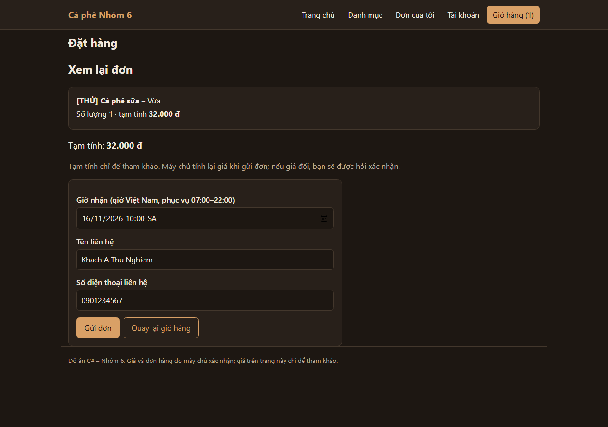

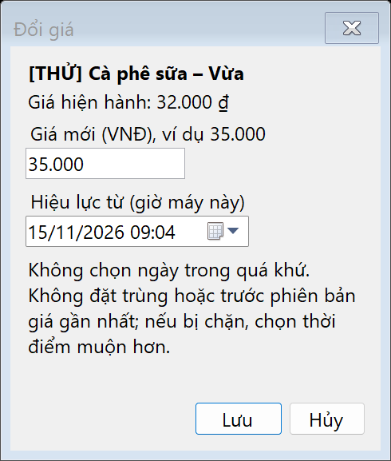
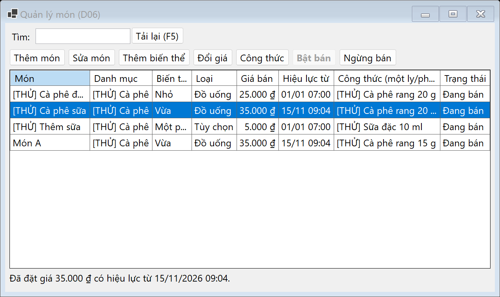
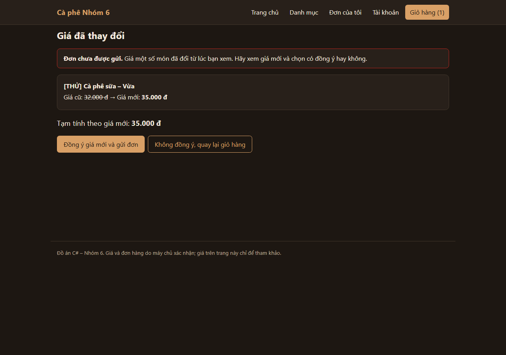


**SQL** (số đơn trước khi gửi):

```sql
SELECT COUNT(*) FROM SalesOrder
```
```text
-
3
```

**SQL** (số đơn sau bước gửi bị chặn):

```sql
SELECT COUNT(*) FROM SalesOrder
```
```text
-
3
```

**SQL** (giá chốt của đơn mới):

```sql
SELECT o.OrderCode, l.UnitPriceSnapshot FROM SalesOrder o JOIN OrderRound r ON r.OrderId = o.OrderId JOIN OrderLine l ON l.RoundId = r.RoundId WHERE o.OrderCode = N'WEB-261115-CU3855RN'
```
```text
OrderCode UnitPriceSnapshot
--------- -----------------
WEB-261115-CU3855RN 35000.00
```

### KT14 – Hủy đơn chờ

| Trường | Nội dung |
|---|---|
| Mã ca / lần chạy | KT14 – lần 1 |
| Ngày giờ, người chạy | 15/11/2026 09:04:58 → 15/11/2026 09:05:05; phụ trách theo kế hoạch: B; khởi chạy: A (công cụ tự động) |
| Phiên bản và môi trường | commit `7a8d253`; xem mục 1 |
| Dữ liệu, tiền điều kiện | dev.customer có đơn đang chờ; đơn KT07 đã được tiếp nhận ở KT08 |
| Các bước đã làm | (1) /don-cua-toi → chọn đơn → Hủy.; (2) Với đơn đã được tiếp nhận (KT08): thử hủy. |
| Kết quả thực tế | Đơn chờ dùng cho ca này: WEB-261115-LDK8ELP9 (OrderId 5); Mở thẳng /don-cua-toi/1/huy: tiêu đề "Đơn WEB-261115-3BLBARFM – Cà phê Nhóm 6"; nội dung: 'Bỏ qua điều hướng\nCà phê Nhóm 6\nTrang chủ\nDanh mục\nĐơn của tôi\nTài khoản\nGiỏ hàng (0)\nLỗi: Đơn không còn ở trạng thái chờ tiếp nhận nên không tự hủy được. Vui l' |
| Trạng thái | **Đạt** |
| Lỗi và chạy lại | Không có lỗi trong lần chạy này. |

> **Lưu ý:** Quan sát: thực đơn Web có thể còn hiện giá cũ vài giây sau khi đổi giá ở D06 (bộ nhớ đệm ngắn). Khi đó giá chính thức vẫn do máy chủ xác nhận ở bước gửi đơn bằng cảnh báo "Giá đã thay đổi". Ở lần chạy này, đơn phụ tạo ngay sau KT10 gặp đúng cảnh báo đó và được đồng ý giá mới trước khi chạy tiếp KT14.

**Kiểm tra:**

- ✔ Hộp (trang) xác nhận nêu đúng mã đơn
- ✔ Sau khi hủy: đơn hiện "Đã hủy", không còn nút hủy
- ✔ SQL: Status = Cancelled
- ✔ Không có phiếu pha chế
- ✔ QuantityReserved không đổi
- ✔ Đơn đã tiếp nhận: không có nút hủy và có lý do
- ✔ SQL: đơn đã tiếp nhận vẫn Serving (không hủy được)

**Ảnh chụp:**

- [KT14-lan1-01.png](bang-chung/KT14-lan1-01.png) – Danh sách "Đơn của tôi" có đơn đang chờ
- [KT14-lan1-02.png](bang-chung/KT14-lan1-02.png) – Chi tiết đơn WEB-261115-LDK8ELP9: có nút Hủy đơn
- [KT14-lan1-03.png](bang-chung/KT14-lan1-03.png) – Trang xác nhận hủy: nêu mã đơn WEB-261115-LDK8ELP9
- [KT14-lan1-04.png](bang-chung/KT14-lan1-04.png) – Đơn WEB-261115-LDK8ELP9 sau khi hủy: Đã hủy
- [KT14-lan1-05.png](bang-chung/KT14-lan1-05.png) – Đơn đã tiếp nhận WEB-261115-3BLBARFM: không có nút hủy
- [KT14-lan1-06.png](bang-chung/KT14-lan1-06.png) – Thử mở thẳng trang hủy của đơn đã tiếp nhận

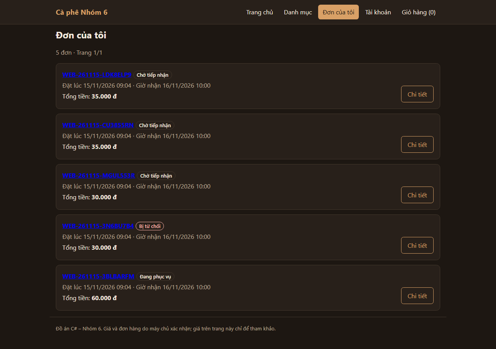

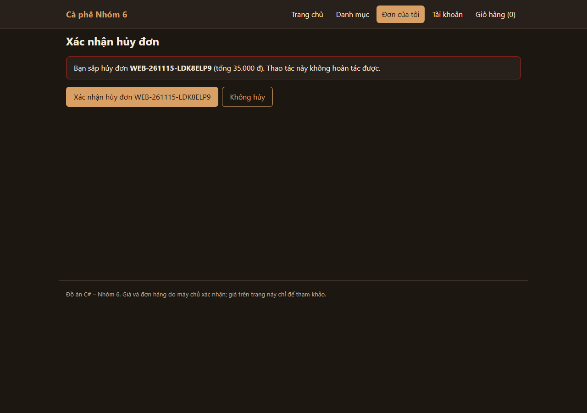
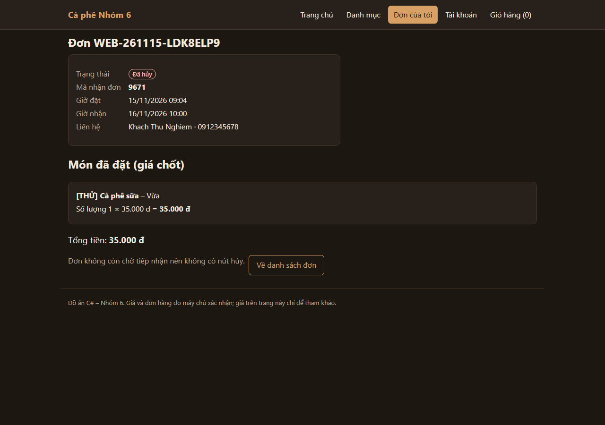

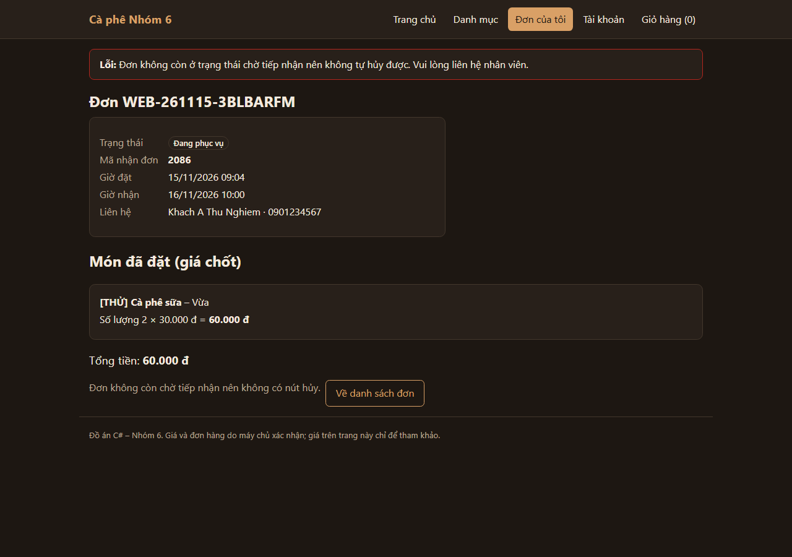

**SQL** (trạng thái sau hủy):

```sql
SELECT Status FROM SalesOrder WHERE OrderId = 5
```
```text
Status
------
Cancelled
```

**SQL** (số phiếu):

```sql
SELECT COUNT(*) FROM PreparationTicket t JOIN OrderRound r ON r.RoundId = t.RoundId WHERE r.OrderId = 5
```
```text
-
0
```

**SQL** (trạng thái đơn đã tiếp nhận):

```sql
SELECT Status FROM SalesOrder WHERE OrderId = 1
```
```text
Status
------
Serving
```

### KT15 – Hết phiên (Desktop)

| Trường | Nội dung |
|---|---|
| Mã ca / lần chạy | KT15 – lần 1 |
| Ngày giờ, người chạy | 15/11/2026 09:05:05 → 15/11/2026 09:05:13; phụ trách theo kế hoạch: C; khởi chạy: A (công cụ tự động) |
| Phiên bản và môi trường | commit `7a8d253`; xem mục 1 |
| Dữ liệu, tiền điều kiện | dev.cashier đăng nhập Desktop, mở D02; vô hiệu hóa nhân viên "Thu ngân thử" bằng SQL rồi khôi phục |
| Các bước đã làm | (1) Đăng nhập dev.cashier → mở D02 (tự làm mới 5 giây).; (2) UPDATE StaffAccount SET IsActive = 0 WHERE FullName = N'Thu ngân thử';; (3) Đợi tối đa 5 giây.; (4) Khôi phục IsActive = 1. |
| Kết quả thực tế | Đã chạy: UPDATE StaffAccount SET IsActive = 0 WHERE FullName = N'Thu ngân thử'; Đã khôi phục: UPDATE StaffAccount SET IsActive = 1 WHERE FullName = N'Thu ngân thử' |
| Trạng thái | **Đạt** |
| Lỗi và chạy lại | Không có lỗi trong lần chạy này. |

**Kiểm tra:**

- ✔ Đăng nhập dev.cashier qua ApiClient
- ✔ D02 đã mở trước khi vô hiệu hóa
- ✔ D02 tự đóng sau khi nhân viên bị vô hiệu hóa (trong 8 giây)
- ✔ Hộp thoại 'Phiên đăng nhập đã hết hạn hoặc bị thu hồi. Vui lòng đăng nhập lại.' đã hiện
- ✔ Màn hình chính yêu cầu quay về đăng nhập (ReturnToLogin)
- ✔ Không còn cửa sổ con nào mở (D02 đã đóng)
- ✔ Dùng phiên cũ gọi API: 401
- ✔ Sau khi khôi phục đăng nhập lại được
- ✔ SQL: nhân viên đã được khôi phục (IsActive = 1)

**Ảnh chụp:**

- [KT15-lan1-01.png](bang-chung/KT15-lan1-01.png) – D02 đang mở (tự làm mới 5 giây) trước khi vô hiệu hóa nhân viên
- [KT15-lan1-02.png](bang-chung/KT15-lan1-02.png) – Hộp thoại: OK | Phiên đăng nhập đã hết hạn hoặc bị thu hồi. Vui lòng đăng nhập lại.

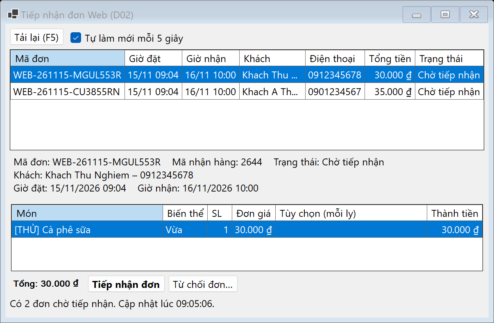
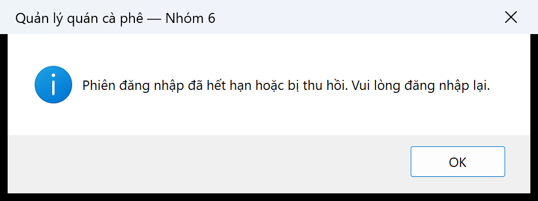

**SQL** (trạng thái sau khi khôi phục):

```sql
SELECT CAST(IsActive AS int) FROM StaffAccount WHERE FullName = N'Thu ngân thử'
```
```text
-
1
```

### KT16 – Quyền sở hữu đơn

| Trường | Nội dung |
|---|---|
| Mã ca / lần chạy | KT16 – lần 1 |
| Ngày giờ, người chạy | 15/11/2026 09:05:13 → 15/11/2026 09:05:17; phụ trách theo kế hoạch: B; khởi chạy: A (công cụ tự động) |
| Phiên bản và môi trường | commit `7a8d253`; xem mục 1 |
| Dữ liệu, tiền điều kiện | Khách A = dev.customer (trình duyệt 1); khách B = khach.b (trình duyệt 2, phiên riêng) |
| Các bước đã làm | (1) Khách B mở /don-cua-toi/6 và /don-cua-toi/6/huy.; (2) B thử gửi lệnh hủy thẳng (POST kèm mã chống giả mạo hợp lệ của chính B). |
| Kết quả thực tế | Đơn của khách A: WEB-261115-62DPS4BX, OrderId 6 (xem trên URL /don-cua-toi/6); POST /don-cua-toi/6/huy từ phiên của B → mã trạng thái 404 |
| Trạng thái | **Đạt** |
| Lỗi và chạy lại | Không có lỗi trong lần chạy này. |

**Kiểm tra:**

- ✔ B xem đơn của A: trang "không tìm thấy" (404), không lộ nội dung
- ✔ B mở trang hủy đơn của A: "không tìm thấy", không có nút xác nhận
- ✔ POST hủy đơn của A từ phiên B bị từ chối (404)
- ✔ SQL: đơn của A vẫn Pending (không đổi)
- ✔ A vẫn xem được đơn của mình

**Ảnh chụp:**

- [KT16-lan1-01.png](bang-chung/KT16-lan1-01.png) – Khách B mở đơn của A (/don-cua-toi/6): trang không tìm thấy
- [KT16-lan1-02.png](bang-chung/KT16-lan1-02.png) – Khách B mở trang hủy của đơn khách A: không tìm thấy
- [KT16-lan1-03.png](bang-chung/KT16-lan1-03.png) – Khách A xem lại đơn WEB-261115-62DPS4BX: vẫn xem được, không đổi


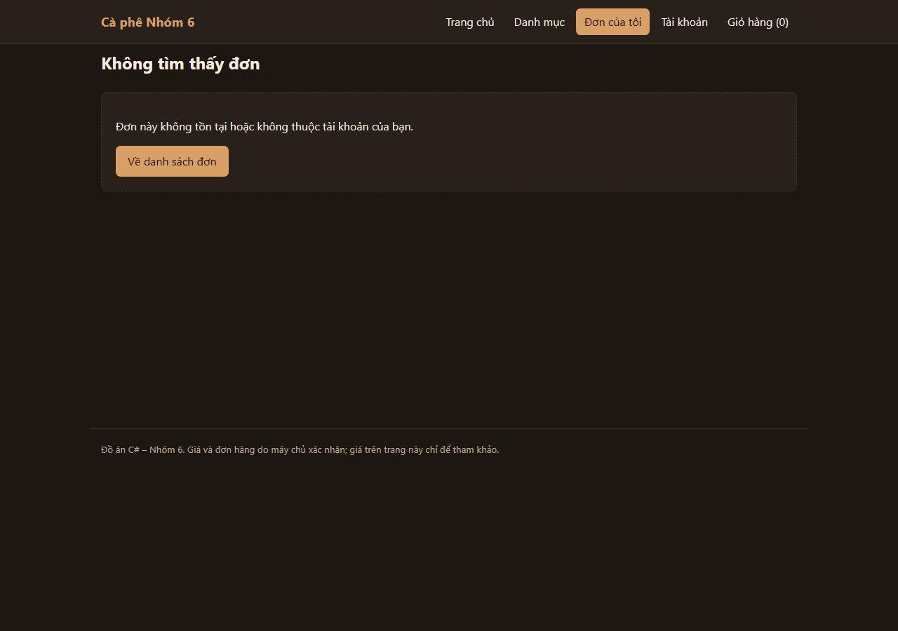
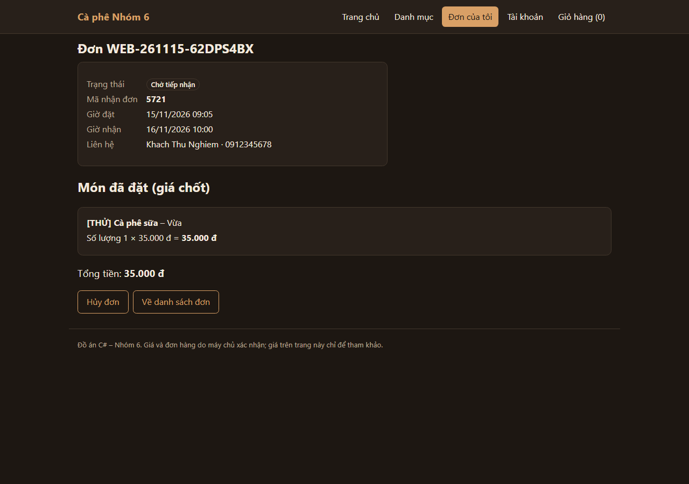

**SQL** (trạng thái đơn của A):

```sql
SELECT Status FROM SalesOrder WHERE OrderId = 6
```
```text
Status
------
Pending
```

### KT17 – Đăng ký tài khoản khách

| Trường | Nội dung |
|---|---|
| Mã ca / lần chạy | KT17 – lần 1 |
| Ngày giờ, người chạy | 15/11/2026 09:04:20 → 15/11/2026 09:04:27; phụ trách theo kế hoạch: B; khởi chạy: A (công cụ tự động) |
| Phiên bản và môi trường | commit `7a8d253`; xem mục 1 |
| Dữ liệu, tiền điều kiện | Trình duyệt riêng cho khách B; tên đăng nhập mới khach.b |
| Các bước đã làm | (1) Mở /tai-khoan/dang-ky, nhập tên đăng nhập mới hợp lệ, mật khẩu ≥ 6 ký tự, họ tên, số điện thoại → Đăng ký.; (2) Đăng nhập bằng tài khoản vừa tạo.; (3) Đăng ký lại cùng tên.; (4) Thử dữ liệu sai: mật khẩu ngắn, xác nhận không khớp, số điện thoại sai. |
| Kết quả thực tế | Sau đăng ký: địa chỉ http://localhost:5055/tai-khoan/dang-nhap; tiêu đề "Đăng nhập – Cà phê Nhóm 6" |
| Trạng thái | **Đạt** |
| Lỗi và chạy lại | Không có lỗi trong lần chạy này. |

**Kiểm tra:**

- ✔ Lần 1 thành công: đăng nhập được, trang tài khoản hiện họ tên Khach B
- ✔ Trùng tên bị từ chối, vẫn ở trang đăng ký, lỗi gần trường
- ✔ Giữ lại giá trị đã nhập (tên đăng nhập, họ tên), mật khẩu bị xóa
- ✔ mật khẩu ngắn: bị từ chối, vẫn ở trang đăng ký, có thông báo lỗi gần trường
- ✔ xác nhận không khớp: bị từ chối, vẫn ở trang đăng ký, có thông báo lỗi gần trường
- ✔ số điện thoại sai: bị từ chối, vẫn ở trang đăng ký, có thông báo lỗi gần trường
- ✔ SQL 1: đúng 1 dòng khach.b có FullName
- ✔ SQL 2: không có tài khoản dở (0)
- ✔ Dữ liệu sai không tạo tài khoản (khach.c/d/e = 0)

**Ảnh chụp:**

- [KT17-lan1-01.png](bang-chung/KT17-lan1-01.png) – Sau khi đăng ký khach.b hợp lệ
- [KT17-lan1-02.png](bang-chung/KT17-lan1-02.png) – Trang tài khoản sau khi đăng nhập khach.b
- [KT17-lan1-03.png](bang-chung/KT17-lan1-03.png) – Đăng ký trùng tên: báo lỗi, giữ lại giá trị đã nhập
- [KT17-lan1-04.png](bang-chung/KT17-lan1-04.png) – Đăng ký với mật khẩu ngắn: báo lỗi
- [KT17-lan1-05.png](bang-chung/KT17-lan1-05.png) – Đăng ký với xác nhận không khớp: báo lỗi
- [KT17-lan1-06.png](bang-chung/KT17-lan1-06.png) – Đăng ký với số điện thoại sai: báo lỗi

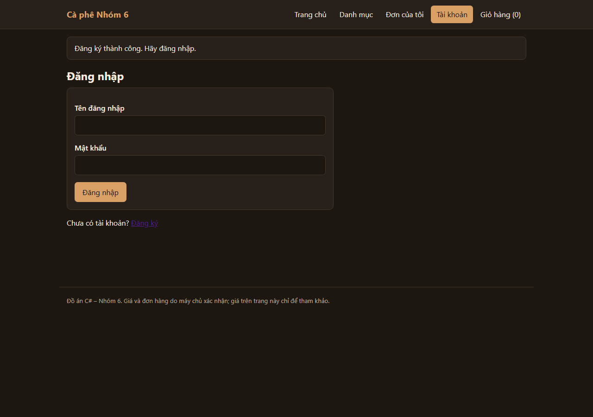


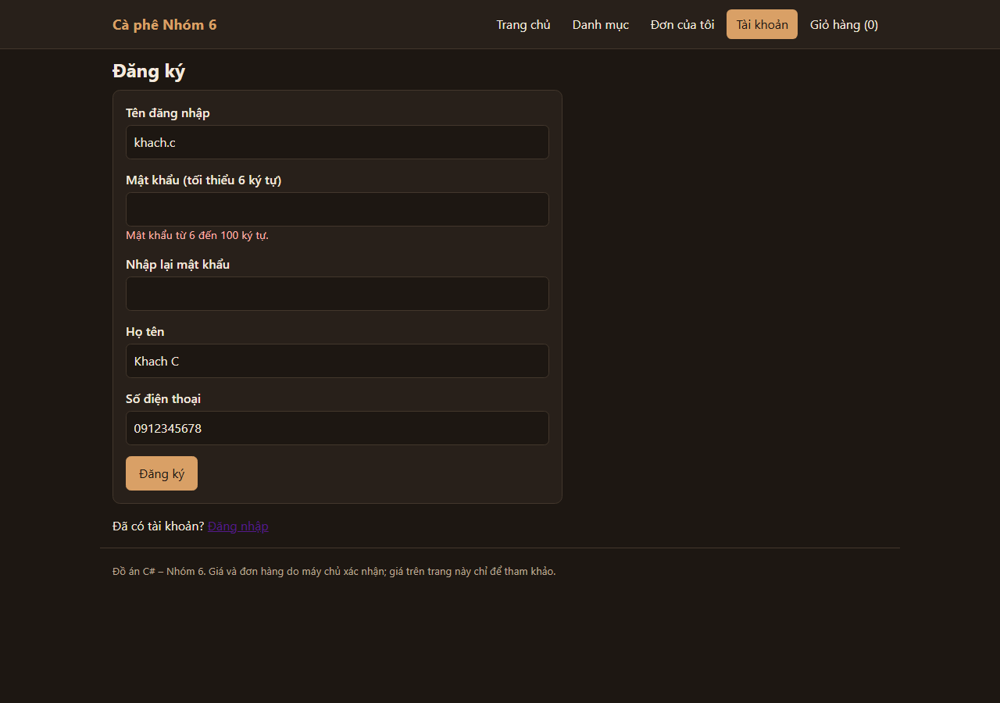
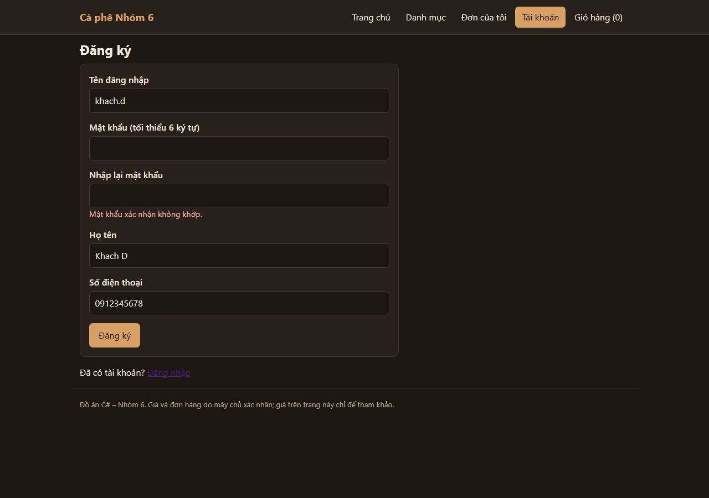
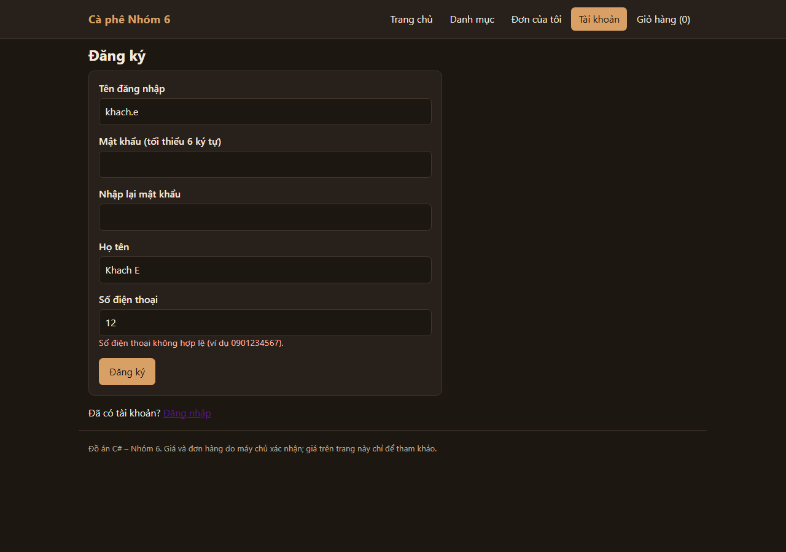

**SQL** (tài khoản khach.b):

```sql
SELECT u.UserName, c.FullName FROM AspNetUsers u LEFT JOIN CustomerProfile c ON c.IdentityUserId = u.Id WHERE u.UserName = N'khach.b';
```
```text
UserName FullName
-------- --------
khach.b Khach B
```

**SQL** (tài khoản không có hồ sơ):

```sql
SELECT COUNT(*) FROM AspNetUsers u WHERE NOT EXISTS (SELECT 1 FROM CustomerProfile c WHERE c.IdentityUserId = u.Id) AND NOT EXISTS (SELECT 1 FROM StaffAccount s WHERE s.IdentityUserId = u.Id);
```
```text
-
0
```

**SQL** (tài khoản của các lần nhập sai):

```sql
SELECT COUNT(*) FROM AspNetUsers WHERE UserName IN (N'khach.c', N'khach.d', N'khach.e')
```
```text
-
0
```

### KT18 – Khoảng hiệu lực giá

| Trường | Nội dung |
|---|---|
| Mã ca / lần chạy | KT18 – lần 1 |
| Ngày giờ, người chạy | 15/11/2026 09:05:17 → 15/11/2026 09:05:21; phụ trách theo kế hoạch: C; khởi chạy: A (công cụ tự động) |
| Phiên bản và môi trường | commit `7a8d253`; xem mục 1 |
| Dữ liệu, tiền điều kiện | D06 với biến thể "[THỬ] Cà phê đen" (chưa có giá hẹn trước) |
| Các bước đã làm | (1) D06: chọn biến thể đã có giá hiện hành.; (2) Đổi giá 31.000 hiệu lực 30 phút nữa.; (3) Đổi giá lần nữa với hiệu lực bây giờ. |
| Kết quả thực tế | Dòng trước khi đổi giá: [THỬ] Cà phê đen ; [THỬ] Cà phê ; Nhỏ ; Đồ uống ; 25.000 ₫ ; 01/01 07:00 ; [THỬ] Cà phê rang 20 g ; Đang bán |
| Trạng thái | **Đạt** |
| Lỗi và chạy lại | Không có lỗi trong lần chạy này. |

**Kiểm tra:**

- ✔ Đăng nhập dev.manager qua ApiClient
- ✔ Giá hẹn 30 phút nữa được nhận
- ✔ Giá hiệu lực 'bây giờ' khi đã có giá hẹn trước bị từ chối, hộp báo lỗi hướng dẫn chọn thời điểm muộn hơn
- ✔ Không có giá 29.000 trong lưới (giá không bị ghi)
- ✔ SQL: chỉ 2 phiên bản (25.000 → 31.000 hẹn trước), không chồng khoảng: EffectiveTo của dòng trước = EffectiveFrom của dòng sau; không có giá 29.000

**Ảnh chụp:**

- [KT18-lan1-01.png](bang-chung/KT18-lan1-01.png) – D06 trước ca KT18: 'Cà phê đen' có giá hiện hành
- [KT18-lan1-02.png](bang-chung/KT18-lan1-02.png) – Đổi giá 31.000 hiệu lực 30 phút nữa
- [KT18-lan1-03.png](bang-chung/KT18-lan1-03.png) – D06 sau khi hẹn giá 31.000 cho 30 phút nữa (giá hiện hành chưa đổi)
- [KT18-lan1-04.png](bang-chung/KT18-lan1-04.png) – Hộp thoại: OK | Đã có giá hiệu lực từ cùng hoặc sau ngày này. Chọn ngày hiệu lực sau phiên bản hiện tại.
- [KT18-lan1-05.png](bang-chung/KT18-lan1-05.png) – D06 sau khi bị từ chối: giá hiện hành không đổi

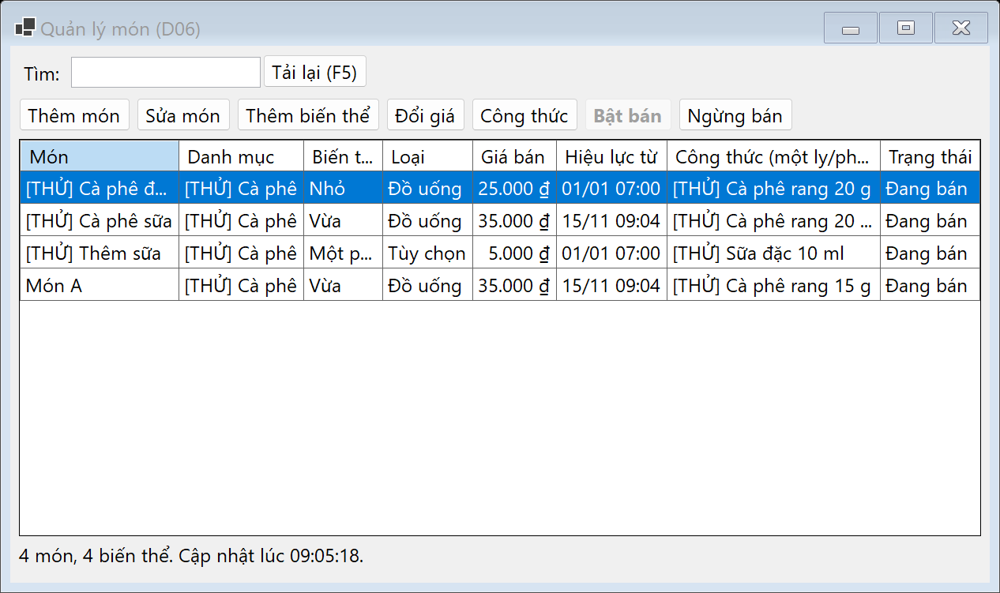
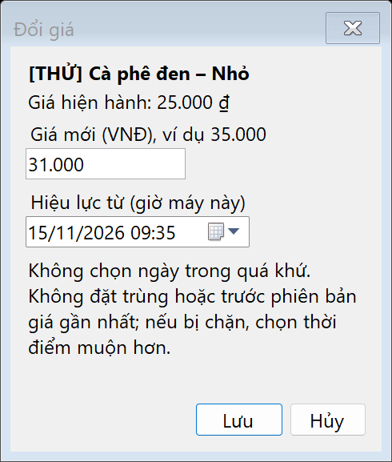
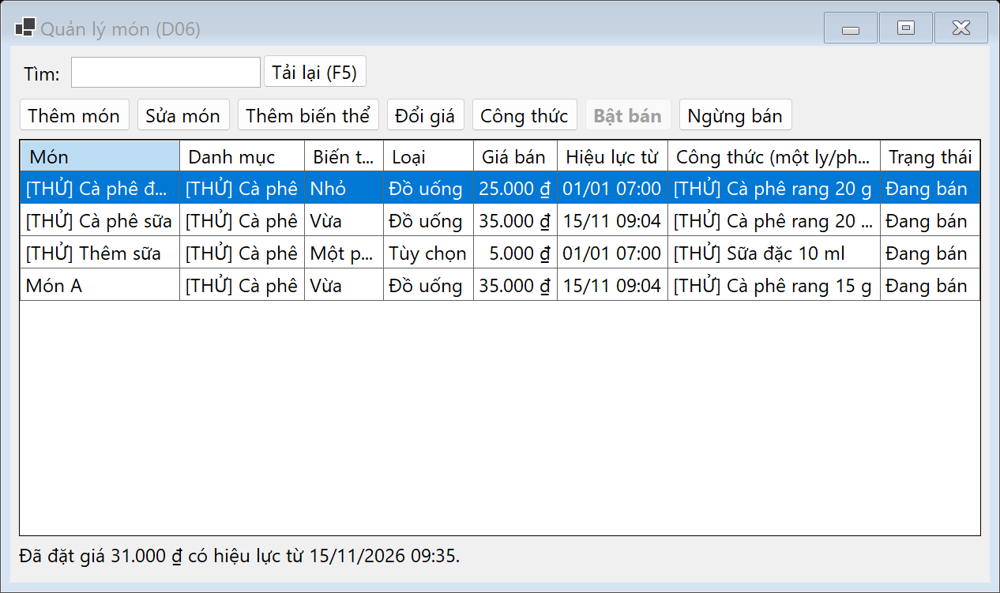


**SQL** (phiên bản giá của Cà phê đen):

```sql
SELECT PriceHistoryId, UnitPrice, EffectiveFrom, EffectiveTo FROM PriceHistory WHERE VariantId = 1 ORDER BY EffectiveFrom;
```
```text
PriceHistoryId UnitPrice EffectiveFrom EffectiveTo
-------------- --------- ------------- -----------
1 25000.00 2026-01-01 00:00:00.0000000 2026-11-15 02:35:19.3527794
8 31000.00 2026-11-15 02:35:19.3527794 NULL
```

### KT19 – Quản lý danh mục và xóa

| Trường | Nội dung |
|---|---|
| Mã ca / lần chạy | KT19 – lần 1 |
| Ngày giờ, người chạy | 15/11/2026 09:05:21 → 15/11/2026 09:05:38; phụ trách theo kế hoạch: C; khởi chạy: A (công cụ tự động) |
| Phiên bản và môi trường | commit `7a8d253`; xem mục 1 |
| Dữ liệu, tiền điều kiện | Món đã có đơn: "[THỬ] Cà phê sữa"; món mới chưa có đơn: "Món A" (tạo ở KT04) |
| Các bước đã làm | (1) Dùng một món đã có đơn và một món mới chưa có đơn.; (2) D06: tìm, Sửa món, Ngừng bán biến thể.; (3) Kiểm tra Web và đơn cũ. |
| Kết quả thực tế | Không có thao tác xóa trong hệ thống; chỉ ngừng bán — nên kỳ vọng gốc "xóa theo quyền khi đủ điều kiện" không được đáp ứng (hạn chế do thiết kế). |
| Trạng thái | **Không đạt** |
| Lỗi và chạy lại | Phần ngừng bán, giữ lịch sử và bật bán lại đạt; phần "xóa" không có chức năng nên không đạt kỳ vọng gốc (hạn chế do thiết kế, không phải lỗi). |

> **Lưu ý:** Hệ thống KHÔNG có chức năng xóa món (cố ý, để giữ lịch sử); chỉ ngừng bán. Biên bản ghi đúng thực tế, không ghi Đạt toàn phần cho kỳ vọng gốc "xóa theo quyền khi đủ điều kiện".

**Kiểm tra:**

- ✔ Đăng nhập dev.manager qua ApiClient
- ✔ Tìm 'Món A' thấy món mới chưa có đơn
- ✔ Hộp Sửa món nói rõ: hệ thống không xóa món, chỉ ngừng bán
- ✔ Ngừng bán 'Món A' (món chưa có đơn): có xác nhận nêu tên món, trạng thái chuyển 'Chưa bán'
- ✔ Ngừng bán 'Cà phê sữa' (món đã có đơn) thành công, món vẫn còn trong D06
- ✔ Món ngừng bán biến mất khỏi Web (/danh-muc)
- ✔ Đơn cũ vẫn thấy tên món và giá chốt ở "Đơn của tôi"
- ✔ Đăng nhập dev.manager qua ApiClient
- ✔ Bật bán lại 'Cà phê sữa' được (món ngừng bán không bị mất)
- ✔ Bật bán lại: món hiện lại trên Web

**Ảnh chụp:**

- [KT19-lan1-01.png](bang-chung/KT19-lan1-01.png) – Hộp thoại Sửa món: ghi chú 'Hệ thống không xóa món…'
- [KT19-lan1-02.png](bang-chung/KT19-lan1-02.png) – Hộp thoại: &Có | &Không | Ngừng bán Món A – Vừa?
- [KT19-lan1-03.png](bang-chung/KT19-lan1-03.png) – D06 sau khi ngừng bán 'Món A'
- [KT19-lan1-04.png](bang-chung/KT19-lan1-04.png) – Hộp thoại: &Có | &Không | Ngừng bán [THỬ] Cà phê sữa – Vừa?
- [KT19-lan1-05.png](bang-chung/KT19-lan1-05.png) – D06 sau khi ngừng bán 'Cà phê sữa' (đã có đơn): món vẫn còn trong danh sách
- [KT19-lan1-06.png](bang-chung/KT19-lan1-06.png) – Web /danh-muc sau khi ngừng bán cả hai món: không còn hiện
- [KT19-lan1-07.png](bang-chung/KT19-lan1-07.png) – Đơn cũ WEB-261115-3BLBARFM vẫn hiện tên món và giá chốt sau khi ngừng bán
- [KT19-lan1-08.png](bang-chung/KT19-lan1-08.png) – D06 sau khi bật bán lại 'Cà phê sữa'
- [KT19-lan1-09.png](bang-chung/KT19-lan1-09.png) – Web /danh-muc sau khi bật bán lại món mẫu


**SQL** (số đơn còn nguyên (không món nào bị xóa)):

```sql
SELECT COUNT(*) FROM SalesOrder
```
```text
-
6
```

### KT21 – Đăng nhập tài khoản khách

| Trường | Nội dung |
|---|---|
| Mã ca / lần chạy | KT21 – lần 1 |
| Ngày giờ, người chạy | 15/11/2026 09:05:38 → 15/11/2026 09:05:50; phụ trách theo kế hoạch: B; khởi chạy: A (công cụ tự động) |
| Phiên bản và môi trường | commit `7a8d253`; xem mục 1 |
| Dữ liệu, tiền điều kiện | dev.customer; trình duyệt khách A |
| Các bước đã làm | (1) /tai-khoan/dang-nhap: dev.customer đúng mật khẩu.; (2) Đăng xuất.; (3) Nhập sai mật khẩu.; (4) Nhập sai 5 lần liên tiếp rồi thử mật khẩu đúng khi đang khóa.; (5) Mở khóa: UPDATE AspNetUsers SET LockoutEnd = NULL, AccessFailedCount = 0 WHERE UserName = N'dev.customer'; |
| Kết quả thực tế | Thông báo khi sai mật khẩu:  / Lỗi: Tên đăng nhập hoặc mật khẩu không đúng. / Tên đăng nhập / Mật khẩu / Đăng nhập /  / Chưa có tài khoản? Đăng ký /  / Đồ án C# – N |
| Trạng thái | **Đạt** |
| Lỗi và chạy lại | Không có lỗi trong lần chạy này. |

**Kiểm tra:**

- ✔ Đúng mật khẩu: có phiên, vào được /don-cua-toi
- ✔ Sau đăng xuất: /don-cua-toi chuyển về đăng nhập
- ✔ Sai mật khẩu: vẫn ở trang đăng nhập, có thông báo lỗi, không có phiên
- ✔ Không có phiên: /don-cua-toi chuyển về đăng nhập
- ✔ Sau 5 lần sai: thông báo tài khoản bị khóa
- ✔ Mật khẩu ĐÚNG khi đang khóa vẫn bị từ chối (không có phiên)
- ✔ SQL: LockoutEnd có giá trị khi đang khóa
- ✔ Lệnh mở khóa chạy được (LockoutEnd = NULL)
- ✔ Sau khi mở khóa đăng nhập được
- ✔ Sau KT21 quyền sở hữu đơn vẫn đúng: khách B vẫn không xem được đơn của A

**Ảnh chụp:**

- [KT21-lan1-01.png](bang-chung/KT21-lan1-01.png) – Trang tài khoản sau khi đăng nhập dev.customer
- [KT21-lan1-02.png](bang-chung/KT21-lan1-02.png) – Đăng nhập sai mật khẩu: thông báo lỗi
- [KT21-lan1-03.png](bang-chung/KT21-lan1-03.png) – Sau 5 lần nhập sai: tài khoản bị khóa
- [KT21-lan1-04.png](bang-chung/KT21-lan1-04.png) – Nhập mật khẩu đúng khi đang bị khóa: vẫn bị từ chối


**SQL** (trạng thái khóa):

```sql
SELECT UserName, LockoutEnd FROM AspNetUsers WHERE UserName = N'dev.customer'
```
```text
UserName LockoutEnd
-------- ----------
dev.customer 2026-11-15 02:20:44.8931756 +00:00
```

**SQL** (mở khóa (sqlcmd có cờ -I)):

```sql
UPDATE AspNetUsers SET LockoutEnd = NULL, AccessFailedCount = 0 WHERE UserName = N'dev.customer'; SELECT UserName, LockoutEnd FROM AspNetUsers WHERE UserName = N'dev.customer';
```
```text
UserName LockoutEnd
-------- ----------
dev.customer NULL
```

### LT01 – Kịch bản liên thông (Desktop → Web → Desktop → SQL)

| Trường | Nội dung |
|---|---|
| Mã ca / lần chạy | LT01 – lần 1 |
| Ngày giờ, người chạy | 15/11/2026 09:06:21 → 15/11/2026 09:06:37; phụ trách theo kế hoạch: A (điều phối); khởi chạy: A (công cụ tự động) |
| Phiên bản và môi trường | commit `7a8d253`; xem mục 1 |
| Dữ liệu, tiền điều kiện | CSDL Dev sạch dựng lại bằng --migrate --seed --seed-accounts |
| Các bước đã làm | — |
| Kết quả thực tế | 09:06:22 — Bắt đầu: quản lý tạo món "Món LT01" trên D06 (như KT04); 09:06:27 — Xong D06: Món LT01 đang bán giá 28.000 đ; 09:06:28 — Khách đăng ký tài khoản mới trên Web (KT17); 09:06:30 — Khách đặt 1 Món LT01 (KT07); Mã đơn LT01: WEB-261115-BTLF6GMH; 09:06:32 — Thu ngân tiếp nhận đơn trên D02 (KT08); Chi tiết dòng món: Món LT01 ; Vừa ; 1 ; 28.000 ₫ ;  ; 28.000 ₫; 09:06:36 — Khách xem "Đơn của tôi"; 09:06:37 — Đối chiếu SQL (KT09); 09:06:37 — Kết thúc; Tổng thời gian: 16 giây |
| Trạng thái | **Đạt** |
| Lỗi và chạy lại | Không có lỗi trong lần chạy này. |

**Kiểm tra:**

- ✔ Đăng nhập dev.manager qua ApiClient
- ✔ Thêm món 'Món LT01': dòng mới hiện 'Chưa có biến thể'
- ✔ Thêm biến thể 'Vừa': 'Chưa bán: thiếu giá và công thức'; nút Bật bán tắt
- ✔ Đổi giá 28.000: 'Chưa bán: thiếu công thức'
- ✔ Có giá và công thức: 'Chưa bán: sẵn sàng bật bán'; nút Bật bán bật
- ✔ Bật bán: trạng thái 'Đang bán'
- ✔ Món LT01 hiện trên Web với giá 28.000 đ
- ✔ Đăng ký và đăng nhập khách mới thành công
- ✔ Đặt đơn thành công: mã đơn, "Chờ tiếp nhận", 28.000 đ
- ✔ Đăng nhập dev.cashier qua ApiClient
- ✔ Danh sách đơn chờ có đơn WEB-261115-BTLF6GMH
- ✔ Chi tiết hiện đúng món, số lượng, tùy chọn và giá chốt
- ✔ Hộp thoại xác nhận nêu đúng mã đơn
- ✔ Sau khi tiếp nhận: đơn rời danh sách chờ, thanh trạng thái báo đã tiếp nhận
- ✔ Khách thấy "Đang phục vụ" trên Web
- ✔ SQL: Serving, 1 × Món LT01, giá chốt 28000
- ✔ SQL: một phiếu pha chế

**Ảnh chụp:**

- [LT01-lan1-01.png](bang-chung/LT01-lan1-01.png) – D06: danh sách món lúc mở
- [LT01-lan1-02.png](bang-chung/LT01-lan1-02.png) – Hộp thoại Thêm món: tên 'Món LT01', danh mục đã chọn
- [LT01-lan1-03.png](bang-chung/LT01-lan1-03.png) – D06 sau khi thêm món 'Món LT01' (chưa có biến thể)
- [LT01-lan1-04.png](bang-chung/LT01-lan1-04.png) – D06 sau khi thêm biến thể 'Vừa': chưa bán, thiếu giá và công thức
- [LT01-lan1-05.png](bang-chung/LT01-lan1-05.png) – D06 sau khi đặt giá 28.000: còn thiếu công thức
- [LT01-lan1-06.png](bang-chung/LT01-lan1-06.png) – Hộp thoại Công thức: một nguyên liệu, định lượng 15 cho một ly
- [LT01-lan1-07.png](bang-chung/LT01-lan1-07.png) – D06 sau khi có công thức: sẵn sàng bật bán
- [LT01-lan1-08.png](bang-chung/LT01-lan1-08.png) – D06 sau Bật bán: Đang bán
- [LT01-lan1-09.png](bang-chung/LT01-lan1-09.png) – Web: Món LT01 đã hiện với giá 28.000 đ
- [LT01-lan1-10.png](bang-chung/LT01-lan1-10.png) – Giỏ hàng: 1 Món LT01, 28.000 đ
- [LT01-lan1-11.png](bang-chung/LT01-lan1-11.png) – Xác nhận đặt đơn WEB-261115-BTLF6GMH
- [LT01-lan1-12.png](bang-chung/LT01-lan1-12.png) – D02 trước khi tiếp nhận: đơn WEB-261115-BTLF6GMH được chọn, chi tiết món bên dưới
- [LT01-lan1-13.png](bang-chung/LT01-lan1-13.png) – Hộp thoại: &Có | &Không | Tiếp nhận đơn WEB-261115-BTLF6GMH?
- [LT01-lan1-14.png](bang-chung/LT01-lan1-14.png) – D02 sau khi tiếp nhận đơn WEB-261115-BTLF6GMH
- [LT01-lan1-15.png](bang-chung/LT01-lan1-15.png) – Web: đơn WEB-261115-BTLF6GMH hiện Đang phục vụ


**SQL** (đơn LT01):

```sql
SELECT o.OrderCode, o.Status, l.ProductNameSnapshot, l.Quantity, l.UnitPriceSnapshot FROM SalesOrder o JOIN OrderRound r ON r.OrderId = o.OrderId JOIN OrderLine l ON l.RoundId = r.RoundId WHERE o.OrderCode = N'WEB-261115-BTLF6GMH'
```
```text
OrderCode Status ProductNameSnapshot Quantity UnitPriceSnapshot
--------- ------ ------------------- -------- -----------------
WEB-261115-BTLF6GMH Serving Món LT01 1 28000.00
```

**SQL** (phiếu của đơn LT01):

```sql
SELECT COUNT(*) FROM PreparationTicket t JOIN OrderRound r ON r.RoundId=t.RoundId JOIN SalesOrder o ON o.OrderId=r.OrderId WHERE o.OrderCode = N'WEB-261115-BTLF6GMH'
```
```text
-
1
```

**SQL** (giá của Món LT01):

```sql
SELECT PriceHistoryId, UnitPrice, EffectiveFrom, EffectiveTo FROM PriceHistory WHERE VariantId = 4
```
```text
PriceHistoryId UnitPrice EffectiveFrom EffectiveTo
-------------- --------- ------------- -----------
4 28000.00 2026-11-15 02:06:25.9285113 NULL
```

**SQL** (tồn kho sau tiếp nhận):

```sql
SELECT IngredientId, QuantityOnHand, QuantityReserved FROM StockBalance ORDER BY IngredientId
```
```text
IngredientId QuantityOnHand QuantityReserved
------------ -------------- ----------------
1 10000.000 15.000
2 10000.000 .000
```
